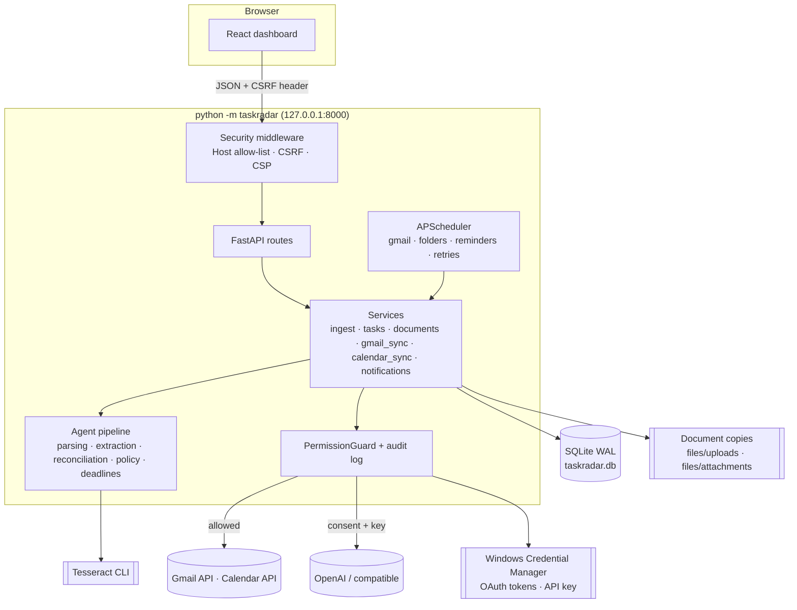

# TaskRadar architecture

TaskRadar is a single local process: a FastAPI application that serves a JSON API and the built React
dashboard on `127.0.0.1:8000`, runs a background scheduler, and stores everything in one SQLite database
under `%LOCALAPPDATA%\TaskRadar`. External services (Gmail, Google Calendar, an optional LLM) are reached only
through guarded connectors.

## Design principles

1. **Local first, least privilege.** Read-only Gmail, a calendar scope limited to calendars TaskRadar created,
   only folders the user adds, loopback-only HTTP. Every external side effect passes one permission guard.
2. **Deterministic before probabilistic.** Parsing, dates, time zones, deduplication keys and policy are code;
   an LLM is optional and its output is validated against the source.
3. **Evidence for every conclusion.** Tasks, deadline changes and completions carry verbatim quotes with page
   numbers; quotes that cannot be located in the source are marked unverified and flagged.
4. **Human in the loop, undo everywhere.** New tasks start as candidates. Automatic changes are limited by a
   policy, recorded as events and revertible (including un-merging).
5. **Never invent.** No date → no deadline. A date without a time stays date-only (never 23:59). Relative dates
   are resolved from the source's date; dates relative to unknown events stay unresolved and flagged.

## Runtime view

Concurrency: SQLite allows one writer, so extraction (slow: OCR, LLM) runs **outside** write transactions,
and a process-wide `INGEST_LOCK` serialises the short "reconcile + apply" step. User-triggered syncs run on a
small thread pool; scheduled jobs on APScheduler's thread. A partial unique index on running jobs prevents two
syncs of the same source; a file lock prevents two servers on the same data folder.

## The pipeline

| Stage | Module(s) | Responsibility |
| --- | --- | --- |
| Input connectors | `connectors/gmail.py`, `connectors/fake_gmail.py`, `services/folders.py`, `api/routes/sources.py` (upload) | Gmail window + history sync, synthetic demo mailbox, watched folders (mtime/size → hash change detection), uploads |
| Normalisation & parsing | `parsing/email_mime.py`, `parsing/html_text.py`, `parsing/documents.py`, `parsing/ocr.py`, `parsing/filetypes.py`, `parsing/language.py` | MIME/HTML to text, quoted-reply stripping, PDF text layer (PyMuPDF) with per-page OCR fallback, OCR pre-processing scaled to the measured line height, magic-byte file typing, language detection |
| Candidate extraction | `extraction/rules.py`, `extraction/lexicon.py`, `extraction/dates.py`, `extraction/llm_extractor.py`, `extraction/hybrid.py`, `extraction/grounding.py`, `extraction/redaction.py`, `llm/*` | Obligations, titles, categories, priorities, deadlines, completion signals, content type (obligation / reminder / marketing …), evidence |
| Task reconciliation | `reconciliation/normalize.py`, `reconciliation/reconciler.py`, `reconciliation/judge.py` | New task, duplicate, deadline update, possible duplicate, completion target |
| Deadline evaluation | `deadlines/engine.py`, `deadlines/reminders.py` | Effective deadline, urgency buckets, reminder planning and de-duplication |
| Human review / policy | `policy/review.py`, `services/tasks.py` | Review reasons, what is applied automatically, revertible events, suggestions, undo/split |
| Actions & notifications | `services/notifications.py`, `notify/desktop.py`, `services/calendar_sync.py`, `connectors/calendar.py` | In-app notifications, Windows toasts, Calendar preview and confirmed writes |
| Orchestration | `services/ingest.py`, `services/documents.py`, `services/gmail_sync.py`, `services/jobs.py`, `scheduler/service.py` | Idempotent processing, transactions, job records, retries, restart recovery |

### Extraction

`RuleBasedExtractor` (version `rules-1.3`) works without network access:

* the text is split into segments (soft line wraps joined without changing offsets, so evidence offsets stay
  valid), the content type is classified (marketing/newsletter scoring, bulk headers, conditional
  "if you have already submitted, ignore this" sentences);
* obligation cues (请/请于/务必, bitte/müssen/ist … zu, please/must/required/could you) and action patterns in
  three languages (including German separable verbs and passives) produce candidates; the instructed action after
  a cue wins over purpose clauses ("为完成注册，请于…上传");
* `extraction/dates.py` parses absolute, relative and approximate dates (11月20日, 20.11.2026, Nov 20, 下周五,
  nächsten Freitag, innerhalb von 14 Tagen, Ende November …), attaches clock times, resolves relative dates from
  the **source date**, converts times stated in UTC to Europe/Berlin, and flags weekday mismatches, missing
  years and periods that start at an unknown event ("14 Tage nach Vertragsunterzeichnung");
* titles are generated per language from the masked sentence ("提交在读证明", "Fehlende Unterlagen einreichen",
  "Sign and return the rental contract");
* completion signals ("我们已收到您的材料", "Zahlung ist eingegangen", "has been received") are classified as
  explicit or hedged.

`LLMExtractor` (prompt `obligation-v1`) sends one message or document per request with a strict JSON schema
(OpenAI structured outputs, or JSON-object mode for compatible servers). The response is validated with
Pydantic; on invalid output it retries a bounded number of times and otherwise fails over to the rules. After
validation every quote is located in the source (`grounding.py`), every date is re-parsed deterministically
from the quoted text, a clock time the source does not contain (e.g. an invented 23:59) is dropped, and
command-like "tasks" are discarded. `HybridExtractor` adds data minimisation (pre-filter: only content with
obligation cues is sent; redaction of identifiers; truncation), the consent/permission check before each call,
and merges rule-only findings the model missed.

### Reconciliation

Three layers, applied to every candidate against existing tasks:

1. **Deterministic** – same source item (re-processing is idempotent), same Gmail thread (with compatible action),
   identical file content (SHA-256).
2. **Normalised similarity** – weighted entity overlap (strong entities only: enrollment certificate,
   residence permit, semester fee …), action compatibility, character n-gram text similarity across scripts, and
   *object overlap* (shared specific CJK terms, uncommon words or reference numbers; generic words and platform
   names such as "TUMonline" or "portal" never count).
3. **Semantic (optional)** – an LLM judge for the grey zone, given only minimal redacted descriptions.

Scores ≥ 0.70 mean "same obligation": duplicate if the deadline matches; a *deadline update* only if the
source announces a change or is a newer reminder/same thread; otherwise a *possible duplicate* suggestion.
Scores in 0.45–0.70 become suggestions when dates agree or the candidate refers back to something; dates more
than 120 days apart are treated as a recurring, related obligation. Completion signals are matched to the best
active task (object overlap, same-date bonus) and must beat the runner-up by a margin.

### Policy

| Situation | Automatic? |
| --- | --- |
| New task detected | Created as **candidate**, never confirmed automatically |
| Low confidence, ambiguous/unconfirmed date, unverified evidence, injection-like text, low OCR quality | Candidate flagged **needs review** with reasons |
| Duplicate notice / reminder | Attached as evidence automatically (revertible: undo splits it into its own task) |
| Explicitly announced deadline change | Applied automatically unless the user edited the deadline (revertible); otherwise a suggestion |
| Explicit, confident completion for a confirmed task | Marked completed automatically (revertible); otherwise a suggestion |
| Hedged completion ("may have", "if you have already …") | Never completes; at most a suggestion |
| Calendar write, autostart, LLM request, delete-all | Only after an explicit user action (and, for LLM, consent) |

### Deadlines and reminders

Deadlines are stored as a local date, an optional `HH:MM` time, the IANA time zone (default Europe/Berlin) and
a precision (`none` / `date` / `datetime`). For urgency only, a date-only deadline counts until the end of that
local day; `zoneinfo` + `tzdata` handle daylight-saving transitions. Buckets: overdue, ≤ 24 h, ≤ 3 days,
≤ 7 days (configurable). Reminders have de-duplication keys (task, deadline version, bucket, repeat window for
overdue), stop for completed/dismissed tasks, and unconfirmed candidates only get a low-frequency overdue/urgent
reminder if the user enables it.

### Jobs and failure handling

Every sync, scan, import and reminder pass is a `sync_jobs` row with counters, error code, `recoverable` flag
and `next_retry_at`. Gmail sync lists the last N days (or uses the history API incrementally), processes
messages oldest first, skips items already processed and moves its checkpoint only after a fully successful
run. HTTP 429/5xx and network errors are retried with exponential back-off and jitter inside the job and then
re-scheduled (2, 4, 8 … minutes, at most 5 attempts); an invalid or revoked token sets the source to
"re-authorization needed" and is never retried blindly. Interrupted jobs are marked on start-up. No failure
deletes stored data.

## Data model

| Table | Content |
| --- | --- |
| `sources`, `sync_checkpoints` | Gmail account, demo mailbox, upload bucket, watched folders; history IDs and scan state |
| `messages` | Normalised mails: Gmail message/thread IDs, web link, sender, dates, labels, body text, status |
| `documents`, `document_pages` | Files (original path or stored copy, SHA-256, size, type), extracted text per page, method, OCR confidence |
| `extraction_runs`, `task_candidates` | One row per extraction run (extractor, model, tokens, cost, latency, trace) and per candidate with the reconciliation decision |
| `tasks` | Title, action, category, priority, status, confidence, deadline fields, review reasons, entities, user-locked fields |
| `task_sources` | Evidence links between tasks and messages/documents with relation (origin, duplicate, deadline update, completion evidence, manual merge) |
| `task_events`, `task_suggestions`, `task_links` | History with before/after data and revert markers; pending suggestions; related tasks |
| `calendar_links` | Google event IDs, sync status and payload hash per task |
| `notifications`, `sync_jobs`, `settings`, `audit_log` | Reminders, job history, typed settings sections, permission decisions |

Timestamps are stored as aware UTC values (a custom `UTCDateTime` type rejects naive datetimes). The schema is
managed by Alembic; migrations run automatically on start-up and with `python -m taskradar migrate`.

## API

All routes live under `/api` (OpenAPI docs at `/api/docs`). Main groups: dashboard and tasks
(`/tasks`, `/tasks/{id}/status`, `/tasks/batch`, `/tasks/{id}/merge`, `/events/{id}/undo`,
`/suggestions/{id}/accept|reject`, `/tasks/{id}/calendar/preview`, `/tasks/{id}/calendar`), sources
(`/sources`, `/sources/{id}/sync`, `/sources/folders`, `/documents/upload`, `/documents`, `/messages`,
`/sync-jobs`, `/failures`, `/agent-runs`, `/demo/*`), integrations (`/integrations/google/*`,
`/oauth/google/callback`) and system (`/session`, `/system/status`, `/settings`, `/settings/llm-key`,
`/notifications`, `/metrics`, `/data/export`, `/data/delete-all`, `/system/autostart`). Errors use one envelope:
`{"error": {"code", "message", "recoverable", "details"}}`; the UI translates codes.

## Frontend

React 19 + TypeScript, Vite, Tailwind CSS v4, Radix UI primitives, TanStack Query, react-router and i18next
(zh-CN default, English). `src/lib/api.ts` adds the CSRF token (fetched from `/api/session`, refreshed once if
the server restarted) and maps the error envelope; `src/lib/queries.ts` wraps every mutation so errors always
surface as toasts and visible data is refreshed. Sources poll quickly while a sync runs, and a watcher refreshes
the screen whenever a sync job starts or finishes. Pages: Dashboard, Review (candidates with an evidence panel,
suggestions), All tasks, Task detail (deadline card with original wording, sources and quotes, calendar
preview, undoable history), Sources, Settings, Insights. `npm run build` writes the bundle into
`backend/src/taskradar/static`, which the backend serves (no external CDN; strict CSP).

## Decisions and trade-offs

* **SQLite instead of a server database** – single user, zero setup, transactional, easy to back up and delete.
* **One agent with tools instead of several LLM agents** – the hard parts are parsing, dates and policy, which
  are better as deterministic code; multiple agents would add cost, latency and failure modes.
* **Rules first, LLM optional** – works offline and private by default; the evaluation makes the recall gap on
  unseen phrasing visible.
* **No automatic calendar sync by default** – calendar entries are visible to others in shared calendars;
  writes need a preview and a click (an opt-in rule exists per category).
* **Credential Manager instead of files** – tokens and keys never sit in the project folder or the database.

## Testing strategy

* Unit tests for date parsing, OCR/PDF/MIME parsing, extraction (rules and mocked LLM failure modes), reconciliation
  and lifecycle, watched folders (in-place reading, change detection, files still being written, recursion), deadlines/DST, Gmail sync with a fake client (429, 5xx, invalid token, network, incremental
  history), Calendar with a fake client (gating, idempotency, ownership), security (CSRF, Host, Origin, uploads,
  path traversal, redaction, folder policy, destructive confirmations, prompt injection).
* An end-to-end test drives the HTTP API through the acceptance scenarios (Chinese PDF, German screenshot,
  reminders, confirmation, completion, failures, restart).
* `python -m taskradar eval` measures extraction and deduplication on labelled synthetic cases
  ([docs/EVALUATION.md](docs/EVALUATION.md)).
* Frontend: Vitest + Testing Library for formatting/DST, the API client (CSRF retry, error envelope), edit diffs,
  translation completeness and components.
