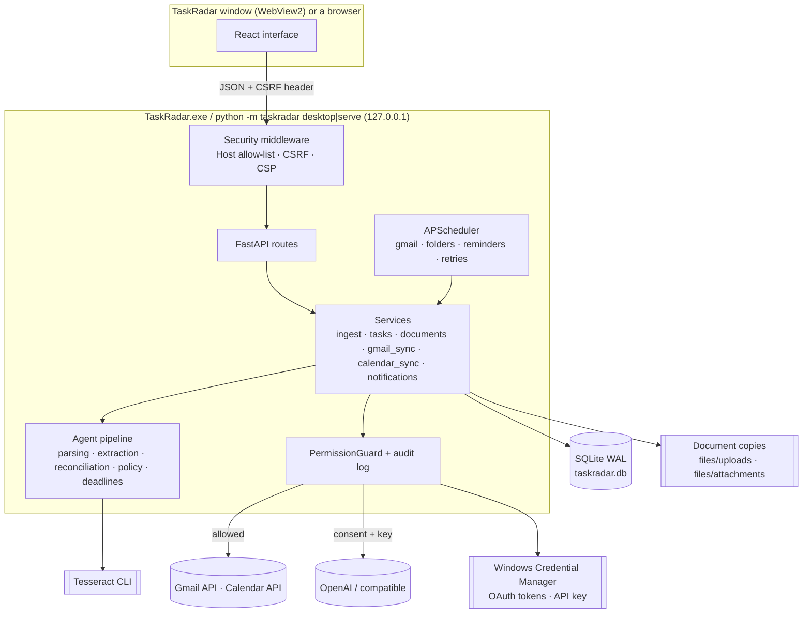

# TaskRadar architecture

TaskRadar is a single local process: a FastAPI application that serves a JSON API and the built React
interface on `127.0.0.1`, runs a background scheduler, and stores everything in one SQLite database
under `%LOCALAPPDATA%\TaskRadar`. Normally that process is the desktop app: a native window (Microsoft Edge
WebView2) shows the interface and the server runs in a thread of the same process, started and stopped with the
window; `taskradar serve` runs the same server for a browser instead. External services (Gmail, Google Calendar,
an optional LLM) are reached only through guarded connectors.

## Design principles

1. **Local first, least privilege.** Read-only Gmail, a calendar scope limited to calendars TaskRadar created,
   only folders the user adds, loopback-only HTTP. Every external side effect passes one permission guard.
2. **Deterministic before probabilistic.** Parsing, dates, time zones, deduplication keys and policy are code;
   an LLM is optional and its output is validated against the source.
3. **Evidence for every conclusion.** Tasks, deadline changes and completions carry verbatim quotes with page
   numbers; quotes that cannot be located in the source are marked unverified and flagged.
4. **Human in the loop, undo everywhere.** New tasks start as candidates. Automatic changes are limited by a
   policy, recorded as events and revertible (including un-merging).
5. **Never invent.** No date → no deadline. A date without a time stays date-only (never 23:59). Relative dates
   are resolved from the source's date; dates relative to unknown events stay unresolved and flagged.

## Runtime view

Concurrency: SQLite allows one writer, so extraction (slow: OCR, LLM) runs **outside** write transactions,
and a process-wide `INGEST_LOCK` serialises the short "reconcile + apply" step. User-triggered syncs run on a
small thread pool; scheduled jobs on APScheduler's thread. A partial unique index on running jobs prevents two
syncs of the same source; a file lock prevents two servers on the same data folder.

## The pipeline

| Stage | Module(s) | Responsibility |
| --- | --- | --- |
| Input connectors | `connectors/gmail.py`, `connectors/fake_gmail.py`, `services/folders.py`, `api/routes/sources.py` (upload) | Gmail window + history sync, synthetic demo mailbox, watched folders (mtime/size → hash change detection), uploads |
| Normalisation & parsing | `parsing/email_mime.py`, `parsing/html_text.py`, `parsing/documents.py`, `parsing/ocr.py`, `parsing/filetypes.py`, `parsing/language.py` | MIME/HTML to text, quoted-reply stripping, PDF text layer (PyMuPDF) with per-page OCR fallback, OCR pre-processing scaled to the measured line height, magic-byte file typing, language detection |
| Candidate extraction | `extraction/rules.py`, `extraction/lexicon.py`, `extraction/dates.py`, `extraction/llm_extractor.py`, `extraction/hybrid.py`, `extraction/grounding.py`, `extraction/redaction.py`, `llm/*` | Obligations, titles, categories, priorities, deadlines, completion signals, content type (obligation / reminder / marketing …), evidence |
| Task reconciliation | `reconciliation/normalize.py`, `reconciliation/reconciler.py`, `reconciliation/judge.py` | New task, duplicate, deadline update, possible duplicate, completion target |
| Deadline evaluation | `deadlines/engine.py`, `deadlines/reminders.py` | Effective deadline, urgency buckets, reminder planning and de-duplication |
| Human review / policy | `policy/review.py`, `services/tasks.py` | Review reasons, what is applied automatically, revertible events, suggestions, undo/split |
| Actions & notifications | `services/notifications.py`, `notify/desktop.py`, `services/calendar_sync.py`, `connectors/calendar.py` | In-app notifications, Windows toasts, Calendar preview, confirmed writes and removal of TaskRadar's own events |
| Quick entry | `extraction/quick_add.py` | One-line to-dos ("周五前交房租") parsed with the same date engine; relative dates count from the moment of typing, a bare weekday means the next one, a time without a deadline word means an appointment |
| Orchestration | `services/ingest.py`, `services/documents.py`, `services/gmail_sync.py`, `services/jobs.py`, `scheduler/service.py` | Idempotent processing, transactions, job records, retries, restart recovery |

### Extraction

`RuleBasedExtractor` (version `rules-1.6`) works without network access:

* the text is split into segments (soft line wraps joined without changing offsets, so evidence offsets stay
  valid), the content type is classified (marketing/newsletter scoring, bulk headers, conditional
  "if you have already submitted, ignore this" sentences);
* obligation cues (请/请于/务必, bitte/müssen/ist … zu, please/must/required/could you) and action patterns in
  three languages (including German separable verbs and passives) produce candidates; the instructed action after
  a cue wins over purpose clauses ("为完成注册，请于…上传");
* `extraction/dates.py` parses absolute, relative and approximate dates (11月20日, 20.11.2026, Nov 20, 下周五,
  nächsten Freitag, innerhalb von 14 Tagen, Ende November …), attaches clock times, resolves relative dates from
  the **source date**, converts times stated in UTC to Europe/Berlin, and flags weekday mismatches, missing
  years and periods that start at an unknown event ("14 Tage nach Vertragsunterzeichnung");
* titles are generated per language from the masked sentence ("提交在读证明", "Fehlende Unterlagen einreichen",
  "Sign and return the rental contract");
* completion signals ("我们已收到您的材料", "Zahlung ist eingegangen", "has been received") are classified as
  explicit or hedged;
* not every request is the reader's duty: mail templates and negated instructions (`rules-1.5`), offers ("you can
  …", "only if you want"), surveys that are not mandatory, legal boilerplate and what the *sender* promises to do
  are skipped; a mere permission is flagged "possibly optional"; polite modals ("could you", "würden Sie") count
  only in a question (`rules-1.6`).

`LLMExtractor` (prompt `obligation-v1`) sends one message or document per request with a strict JSON schema
(OpenAI structured outputs, or JSON-object mode for compatible servers). The response is validated with
Pydantic; on invalid output it retries a bounded number of times and otherwise fails over to the rules. After
validation every quote is located in the source (`grounding.py`), every date is re-parsed deterministically
from the quoted text, a clock time the source does not contain (e.g. an invented 23:59) is dropped, and
command-like "tasks" are discarded. `HybridExtractor` adds data minimisation (pre-filter: only content with
obligation cues is sent; redaction of identifiers; truncation), the consent/permission check before each call,
and merges rule-only findings the model missed.

### Reconciliation

Three layers, applied to every candidate against existing tasks:

1. **Deterministic** – same source item (re-processing is idempotent), same Gmail thread (with compatible action),
   identical file content (SHA-256). An identical copy reuses the first file's text instead of being parsed and
   OCR-ed again (a sender's logo arrives with every mail), unless the first file was read without OCR and OCR is
   available now.
2. **Normalised similarity** – weighted entity overlap (strong entities only: enrollment certificate,
   residence permit, semester fee …), action compatibility, character n-gram text similarity across scripts, and
   *object overlap* (shared specific CJK terms, uncommon words or reference numbers; generic words and platform
   names such as "TUMonline" or "portal" never count).
3. **Semantic (optional)** – an LLM judge for the grey zone, given only minimal redacted descriptions.

Scores ≥ 0.70 mean "same obligation": duplicate only if the deadline matches (same day and, when both state a
time, the same time); a *deadline update* only if the new source explicitly announces the change; any other
difference in deadline, also from a newer reminder in the same thread, becomes a *possible duplicate*
suggestion that the UI shows as "deadlines disagree" - never a silent merge. Test data is only ever compared
with test data.
Scores in 0.45–0.70 become suggestions when dates agree or the candidate refers back to something; dates more
than 120 days apart are treated as a recurring, related obligation. Completion signals are matched to the best
active task (object overlap, same-date bonus) and must beat the runner-up by a margin.

### Policy

| Situation | Automatic? |
| --- | --- |
| New task detected | Created as **candidate**, never confirmed automatically |
| Low confidence, ambiguous/unconfirmed date, unverified evidence, injection-like text, low OCR quality | Candidate flagged **needs review** with reasons |
| Duplicate notice / reminder | Attached as evidence automatically (revertible: undo splits it into its own task) |
| Explicitly announced deadline change | Applied automatically unless the user edited the deadline (revertible), flagged `deadline_changed` and announced in a notification; the user keeps the new date (`/tasks/{id}/review/resolve`, revertible) or undoes the change; otherwise a suggestion |
| Same obligation, different deadline, no explicit change | Never merged automatically: a possible-duplicate suggestion (deadline conflict) |
| Test data (demo mailbox, files imported as test data, tasks marked as such) | Kept apart: not counted in the dashboard or metrics, no reminders, never written to the calendar (409 `sample_task`), never merged with real tasks (409 `sample_mismatch`) |
| Explicit, confident completion for a confirmed task | Marked completed automatically (revertible); otherwise a suggestion |
| Hedged completion ("may have", "if you have already …") | Never completes; at most a suggestion |
| Calendar write, autostart, LLM request, delete-all | Only after an explicit user action (and, for LLM, consent) |
| Calendar event of a task the user dismisses, merges away or deletes | Removed (opt-in setting, on by default; only the event TaskRadar created for that task) |
| Merging two tasks whose deadlines differ | Only with an explicit choice of the date that stays (`due_choice`: `existing` / `new`); without it the API answers 409 `due_choice_required` |
| The user's decision on a suggestion (merge, keep separate, accept, reject) | Recorded as a revertible event: undo reverts what was applied (status, deadline or merge) and reopens the suggestion; "keep separate" also clears the possible-duplicate flag |

### Deadlines and reminders

Deadlines are stored as a local date, an optional `HH:MM` time, the IANA time zone (default Europe/Berlin) and
a precision (`none` / `date` / `datetime`). For urgency only, a date-only deadline counts until the end of that
local day; `zoneinfo` + `tzdata` handle daylight-saving transitions. Buckets: overdue, ≤ 24 h, ≤ 3 days,
≤ 7 days (configurable). Reminders have de-duplication keys (task, deadline version, bucket, repeat window for
overdue), stop for completed/dismissed tasks, and unconfirmed candidates only get a low-frequency overdue/urgent
reminder if the user enables it.

### Jobs and failure handling

Every sync, scan, import and reminder pass is a `sync_jobs` row with counters, error code, `recoverable` flag
and `next_retry_at`. Gmail sync lists the last N days (or uses the history API incrementally), processes
messages oldest first, skips items already processed and moves its checkpoint only after a fully successful
run. Gmail API requests are paced (at most one every 0.2 s): a first sync against a real account hit Google's
per-user `403 rateLimitExceeded` at a few requests per second. Rate limits, HTTP 429/5xx and network errors are
retried with exponential back-off and jitter inside the job (rate limits from 2 s, others from 1 s, at most 32 s,
6 attempts; a `Retry-After` is honoured as a minimum) and then re-scheduled (2, 4, 8 … minutes, at most
5 attempts); an invalid or revoked token sets the source to "re-authorization needed" and is never retried
blindly. A mail deleted in Gmail between listing and fetching (404) is counted as skipped (`gone`) and no
longer keeps the checkpoint from moving. Interrupted jobs are marked on start-up. No failure deletes stored data.

`services/status_summary.py` condenses sources, job history, calendar links, reminder runs, the LLM fallbacks and
the scheduler into a few items (`GET /api/system/summary`: code, level, area, parameters, since when, where to
fix it); the UI phrases them in the user's language, so nobody has to read the log.

`services/recheck.py` runs the current rule engine again over the stored sources of open, extracted tasks
(read-only, no LLM) and reports tasks the rules no longer find, tasks merged from many sources of which few still
support them, and tasks the rules would flag (`GET /api/review/recheck`). It changes nothing; the user decides.

Files imported while no OCR engine was installed keep an `ocr_unavailable` warning. While Tesseract is missing
it is looked for again at most every 30 s, so installing it needs no restart; the Sources page then offers to
read those files again in a `reprocess` job (oldest first, so identical copies reuse the first result).

## Data model

| Table | Content |
| --- | --- |
| `sources`, `sync_checkpoints` | Gmail account, demo mailbox, upload bucket, watched folders; history IDs and scan state |
| `messages` | Normalised mails: Gmail message/thread IDs, web link, sender, dates, labels, body text, status |
| `documents`, `document_pages` | Files (original path or stored copy, SHA-256, size, type), extracted text per page, method, OCR confidence |
| `extraction_runs`, `task_candidates` | One row per extraction run (extractor, model, tokens, cost, latency, trace) and per candidate with the reconciliation decision |
| `tasks` | Title, action, category, priority, status, confidence, deadline fields, review reasons, entities, user-locked fields, `sample` (test data) |
| `task_sources` | Evidence links between tasks and messages/documents with relation (origin, duplicate, deadline update, completion evidence, manual merge) |
| `task_events`, `task_suggestions`, `task_links` | History with before/after data and revert markers; pending suggestions; related tasks |
| `calendar_links` | Google event IDs, sync status and payload hash per task |
| `notifications`, `sync_jobs`, `settings`, `audit_log` | Reminders, job history, typed settings sections, permission decisions |

Timestamps are stored as aware UTC values (a custom `UTCDateTime` type rejects naive datetimes). The schema is
managed by Alembic; migrations run automatically on start-up and with `python -m taskradar migrate`.

## API

All routes live under `/api` (OpenAPI docs at `/api/docs`). Main groups: dashboard and tasks
(`/tasks`, with `needs_decision=true` for the "To confirm" queue: candidates and tasks with a pending
suggestion; `/tasks/{id}/status`, `/tasks/batch`, `/tasks/{id}/merge`, `/events/{id}/undo`,
`/suggestions/{id}/accept|reject`, `/tasks/{id}/calendar/preview`, `/tasks/{id}/calendar`,
`/tasks/{id}/calendar/remove`, `/tasks/quick-parse` for one-line to-dos, `/tasks/{id}/sample`,
`/tasks/{id}/review/resolve`, `/review/recheck`), sources
(`/sources`, `/sources/{id}/sync`, `/sources/folders`, `/documents/upload`, `/documents`, `/messages`,
`/sync-jobs`, `/failures`, `/agent-runs`, `/demo/*`), integrations (`/integrations/google/*`,
`/oauth/google/callback`) and system (`/session`, `/system/status`, `/system/summary`, `/settings`, `/settings/llm-key`,
`/notifications`, `/metrics`, `/data/export`, `/data/delete-all`, `/system/autostart`, and `/desktop/state` in the
desktop app). Errors use one envelope:
`{"error": {"code", "message", "recoverable", "details"}}`; the UI translates codes. Responses to a change
(status, batch, merge, suggestion decision) carry `undo_event_id` / `undo_event_ids`, which the UI offers as
"Undo"; `/dashboard` returns an `attention` list ordered by time (overdue, due today, due tomorrow, due within
7 days, then changed or disputed deadlines; confirmed before unconfirmed within a group) with `attention_flags`
(unconfirmed, conflict, date_changed), `attention_counts`, non-overlapping counts (`needs_action`, `due_soon`,
`due_soon_candidates`, `overdue_candidates`, `sample_open`, and `ever_confirmed`, which ends the first-run
guide) and suggestions that name both tasks with their status and deadline (`deadlines_differ`). Task summaries
list the kinds of their pending suggestions (`pending_suggestion_kinds`), so a list can show "possible
duplicate" or "deadline update" without loading each task. An unclear date keeps the specific reason next to
`ambiguous_date` (`weekday_mismatch`, `day_month_order_ambiguous`, `next_weekday_ambiguous`,
`this_week_day_already_passed`, `weekday_equals_source_day`, `approximate_date`,
`period_starts_at_unknown_event`), so the UI can say why instead of listing every possible cause. A failed
file is kept and can be processed again (`/documents/{id}/reprocess`, `/messages/{id}/reprocess`).

## Frontend

React 19 + TypeScript, Vite, Tailwind CSS v4, Radix UI primitives, TanStack Query, react-router and i18next
(zh-CN default, English). `src/lib/api.ts` adds the CSRF token (fetched from `/api/session`, refreshed once if
the server restarted) and maps the error envelope; `src/lib/queries.ts` wraps every mutation so errors always
surface as toasts (with "Undo" when the response names an undo event) and visible data is refreshed. Sources
poll quickly while a sync runs, and a watcher refreshes the screen whenever a sync job starts or finishes.

Navigation is named by what the user does: Today (dashboard), To confirm (one queue for new tasks, deadline
updates and possible duplicates), My tasks, Add content (imports and sources) and Settings, which also leads to
Activity and diagnostics (`/insights`). One way to add a to-do ("Add to-do" in the top bar) and one search per
screen (the task list has its own; elsewhere the top bar's opens it).

Layout: a fixed frame (sidebar, top bar) with one scroll container for the page; To confirm is a full-height
route whose list and detail scroll separately from 1280 px and take turns below, so the detail keeps enough
width next to the sidebar. Long words and titles wrap inside their column (`min-w-0`, single-column grids,
`overflow-wrap: anywhere`) instead of widening the page. Shared pieces:
`lib/review.ts` turns internal review codes into a few plain-language issues and computes the inbox order
(overdue, due within three days, conflicts and open suggestions, due within a week, other doubts, later, no
deadline - never by the extractor's score); `TaskListItem` (title, deadline and at most two states; category
and sources live in the task; in a narrow list the date moves under the title, decided by the list's own width
through container queries), `DeadlineIndicator`, `TaskDetailView` (deadline and main actions, open questions
whose fix buttons open the field concerned with the original wording, quotes per source, then calendar,
history; technical details in a dialog from the "…" menu), `TaskEditDialog` (adding: one sentence, the
recognised date in editable fields, the rest under "More options"; editing with an intent, so "Edit & confirm"
saves and confirms while "Save only" stays possible), `DuplicateCompare` and `DueChoicePicker` (side-by-side
review of a possible duplicate with the required date choice; on phones only what differs and the deadline,
the rest one tap away), `KeyStates` (at most two coloured states per row; "N more" opens the rest, also by
touch), `StatusMenu` and `CompleteToggle` (one-step completion with undo; other statuses behind "…"; the box
shows what was asked for until the task itself reports its status again, so box, label and title always agree
after completing, reopening or undoing; a row's fade lasts only until the list shows the change), `SystemStatus` (one line while everything works, otherwise the problems with where
to fix them), `LastImportCard` with `lib/upload.ts` (the last import's result stays for the session: what was
found, new tasks and suggestions counted in their own units, with the way to confirm it, and each file's
outcome with "retry" for failures that may pass or "another file" otherwise), `RecheckDialog`, `TechnicalDetails` (scores, rule signals and IDs, labelled as uncalibrated
debugging aids) and `lib/records.ts` (mails and files as one processing list, attachments under their mail,
every outcome with a reason). Settings show one category at a time (`?section=`); unsaved edits are protected
on every way out (another category, the sidebar, links, back/forward via `useBlocker`; closing the window via
`beforeunload` in a browser, and in the desktop app through `useUnsavedChanges`, which tells the window so that
Windows' own question appears), and appearance and language say that they apply at once. Gmail is connected step by step, with
the technical details folded away. On touch screens `.touch-target` gives small controls a tap area of at
least 44 px without changing their drawn size, and the buttons that finish a dialog or a decision are 44 px
tall on phones (`DialogActions`: the buttons that finish a dialog stay in view at its bottom). In To confirm
the decision bar sits at the bottom edge of the pane and publishes its height (`lib/toastClearance.ts`), which
the toaster adds to its offset; toasts rise only a little into place and take no taps while arriving or
leaving, so a tap meant for the next decision never lands on "Undo". After a decision the next task is read
from its start (the pane's scroll is reset; the list keeps its own) and, where the list gives way to the task,
its title takes the focus. A fix for a date shows the whole sentence it came from, with the date and a weekday
written next to it marked. A task the user just added is highlighted for a moment in whichever list shows it;
`prefers-reduced-motion` switches off non-essential motion.
Colours, type, sizes and motion come from tokens in `src/index.css` (light and `.dark`). Surfaces: a light frame
(`--frame` `#f2f3f5`; dark `#1d1e22`) holds the sidebar and the top bar, and the page sits on one white work
surface (`--background`; dark `#25262b`) with a rounded top-left corner; sections are separated by space, thin
dividers and a subtle tint (`--subtle`) rather than boxed cards. Colour has fixed meanings: indigo (`--primary`
`#4f46e5`) for the one main action of a page, the selection (`--selected`) and focus; red for overdue and
destructive actions, amber for warnings and disputed dates, green for done, a dashed grey outline (`--tentative`)
for unconfirmed, grey for everything descriptive. Type: Segoe UI Variable Text/Display with Microsoft YaHei UI;
`text-page` (20/28) and `text-section` (15/22) set the heading scale. Radii 6 px (controls), 8 px (menus,
panels), 12 px (dialogs, the page); controls 32 px (28 / 24 small, 40 large); hover and pressed states are
translucent overlays, disabled is 45 % opacity, and `Button` has a `loading` state (spinner, keeps its width,
`aria-busy`). Icons are Lucide at a 1.75 stroke; an icon without an obvious meaning gets a label or a tooltip.
Motion (`--duration-fast/normal/slow` 120/160/200 ms, `--ease-out`): pages fade in with a small rise
(`.motion-page`), menus and popovers drop in from their side, dialogs and the drawer rise or slide in and leave
faster than they came; closing elements take no pointer events, so quick clicks reach what is underneath. A
ticked-off row folds away (`useFoldAway` keeps an inert ghost of it while its height collapses in 200 ms), so the
rows below move up instead of jumping. The sidebar collapses to a 76 px rail with labels (remembered; automatic below
1100 px) and becomes a drawer on phones. `prefers-reduced-motion` (in WebView2: Windows' "Animation effects")
removes the motion.
Pages: Today, To confirm, My tasks, Task detail, Add content, Settings, Activity and diagnostics.
`npm run build` writes the
bundle into `backend/src/taskradar/static`, which the backend serves (no external CDN; strict CSP).

## Desktop app

`taskradar desktop` (the default of the packaged program) is the server plus a window, in one process
(`taskradar/desktop/`):

* **Start** (`shell.run`). Per-monitor DPI awareness; one TaskRadar per data folder through the folder's file lock.
  A second start finds the open window (by process and title) and brings it to the front, waits a moment when
  the other one is just closing, or, when the folder is used by `taskradar serve` (`instance.json` records the
  mode and URL), offers to open that in the browser. Without the WebView2 runtime it says so and offers
  Microsoft's download page. The server takes port 8000 when it is free, otherwise any free loopback port.
* **Server** (`server.BackgroundServer`): the same container and FastAPI app as `serve`, run by uvicorn in a thread;
  the window shows a small start page (inline HTML in the saved or Windows theme) until the server answers, then
  loads the app; if the server cannot start, an error page names the log file.
* **Window** (pywebview on Microsoft Edge WebView2, WinForms): at least 720×440. `prefs.py` restores size, position
  and maximised state from `desktop.json` when the title bar would still be reachable on a current screen,
  rescaled when the DPI changed; otherwise it centres 1280×860 on the primary screen (maximised on small screens).
  The native title bar takes the page's frame colour and text colour (DWM attributes) in light and dark.
* **Page ↔ window.** The app's Content-Security-Policy forbids `eval`, which pywebview's JS bridge needs, so the
  page reports to the window over HTTP: `PUT /api/desktop/state` (CSRF-protected; 404 outside the desktop app)
  carries unsaved changes, theme and language. Closing with unsaved changes asks with a Windows message box
  ("No" is the default). Only the app's own address loads in the window; other links (http, https, mailto) open
  in the default browser; the context menu keeps only editing commands. Google sign-in opens in the default
  browser; the callback on the local server records the result (`last_authorization` with a sequence number),
  shows a "close this tab" page and brings the window forward, and the settings page, which polls the status,
  takes the result over.
* **Close.** Window geometry is saved, the server shuts down (at most 5 s for running requests) and the container
  is disposed; then the process ends without waiting for the .NET runtime to unload (several seconds otherwise).
  WebView2 keeps its profile (local storage such as the sidebar mode) in `<data>\webview`.
* `TASKRADAR_WEBVIEW_DEBUG_PORT` opens WebView2's DevTools port for automated checks only
  (`scripts/desktop-check`); it is never set by the app.

**Installing** (`packaging/installer.py`, `taskradar/desktop/install.py`). `TaskRadar-Setup-<version>.exe` is a
one-file PyInstaller program that carries the portable zip and shows `installer.html` in a small WebView2 window
(pywebview's JS bridge on this local page; the API object keeps all state private, so the page reaches only
`info`, `install`, `open_app` and `close`). It installs for the current user into
`%LOCALAPPDATA%\Programs\TaskRadar`: it refuses a non-empty folder without its `install.json` ("not ours"),
checks that every archive member stays inside the folder, unpacks into `TaskRadar.new` and swaps the folders
(when the old one is in use, nothing changes and it says to close TaskRadar). It creates the Start menu and,
optionally, the desktop shortcut (COM `IShellLinkW`) and the entry in Settings → Apps (HKCU `Uninstall` key with
`UninstallString` = `TaskRadar.exe uninstall`); `install.json` records them. `TaskRadar.exe uninstall` asks first,
refuses while a program runs from the folder, removes only shortcuts that point into the folder, the autostart
entry only if it is TaskRadar's own, the registry entry only if its location matches, then has a hidden PowerShell
remove the program folder once the uninstaller has ended. Data and secrets stay; the message says where.
`--silent`, `--quiet` and path options make installing and uninstalling testable without touching the real Start
menu or registry.

## Packaging

`packaging/taskradar.spec` builds the windowed TaskRadar.exe with PyInstaller (`scripts\build-exe.ps1`, which also
builds the web UI, zips the portable folder and builds the installer around it). `packaging/launcher.py` runs the
same command line as `python -m taskradar` (`desktop` when double-clicked); commands that print (`serve`, `migrate`,
`eval`, `--version`, help) attach to the console they were started from, and a failed start is logged and shown in
a message box. The web UI, the migrations (Alembic loads them as files), the demo samples, the evaluation data and
the icon are packed at the paths the code finds through `__file__`, so the code is the same as from source; of the
Google client's discovery documents only Gmail and Calendar are kept (the others are about 100 MB); pywebview's
WinForms/WebView2 backend and pythonnet are included, the Qt and GTK backends are not.
Differences when packaged (`taskradar.packaged`): `.env` is read next to the exe, autostart starts the exe itself
(minimised), and `/api/system/status` reports `packaged`, so the OCR hint names `Install-OCR.cmd`.
Data, secrets and Tesseract stay where the source version keeps them. The folder build starts faster; the
one-file build (`-OneFile`) unpacks itself into `%TEMP%` on every start and removes that copy when it ends.

## Decisions and trade-offs

* **SQLite instead of a server database** – single user, zero setup, transactional, easy to back up and delete.
* **One agent with tools instead of several LLM agents** – the hard parts are parsing, dates and policy, which
  are better as deterministic code; multiple agents would add cost, latency and failure modes.
* **Rules first, LLM optional** – works offline and private by default; the evaluation makes the recall gap on
  unseen phrasing visible.
* **No automatic calendar sync by default** – calendar entries are visible to others in shared calendars;
  writes need a preview and a click (an opt-in rule exists per category).
* **Credential Manager instead of files** – tokens and keys never sit in the project folder or the database.

## Testing strategy

* Unit tests for date parsing, OCR/PDF/MIME parsing, extraction (rules and mocked LLM failure modes), reconciliation
  and lifecycle, watched folders (in-place reading, change detection, files still being written, recursion), deadlines/DST, Gmail sync with a fake client (429, 5xx, invalid token, network, incremental
  history), Calendar with a fake client (gating, idempotency, ownership), security (CSRF, Host, Origin, uploads,
  path traversal, redaction, folder policy, destructive confirmations, prompt injection).
* An end-to-end test drives the HTTP API through the acceptance scenarios (Chinese PDF, German screenshot,
  reminders, confirmation, completion, failures, restart).
* Desktop (`tests/test_desktop.py`): window placement (first start, small screens, a screen that is gone, an
  unreachable title bar, DPI changes), saved preferences, the page ↔ window state route (CSRF, validation, 404
  outside the app), the Google callback in the desktop app, the background server starting and stopping on a real
  port, and installing for real into temporary folders with a test registry key: shortcuts, update, removal,
  refusing a foreign folder, an archive escaping its folder and an update while TaskRadar runs, finding programs
  that run from a folder, removing the program folder after the uninstaller ended, and the installer page's API.
  `scripts/desktop-check/flow.mjs` drives the real window (WebView2 through the DevTools protocol, Win32 for the
  window itself) through start → add content → confirm → view → complete.
* `python -m taskradar eval` measures extraction and deduplication on labelled synthetic cases
  ([docs/EVALUATION.md](docs/EVALUATION.md)).
* Frontend: Vitest + Testing Library for formatting/DST, the API client (CSRF retry, error envelope), edit diffs,
  translation completeness and components, including the review flows: issue mapping and inbox order,
  keyboard navigation and moving on after a decision, undo toasts, the duplicate comparison (date choice
  required, correct API call) and the processing records (grouping, reasons, failures first), the dashboard
  (time groups, conflict and unconfirmed marks, suggestion texts, test data note, system status, decision card,
  first-run guide), at most two states per row and test data listed after real candidates; the edit dialog
  (edit & confirm by default from that entry, save only, add with one sentence), the settings guard on every
  navigation, Gmail status while unknown, accessible names in the top bar, one-step completion, import results
  with retries, and the highlight of a just-added task. Cross-state tests follow one control through several
  changes: the same completion box re-rendered with the updated task (done, reopened, undone), a task ticked
  off and brought back in the open list (no fade left behind), the next task after a decision (scroll position
  and focus), toasts kept clear of the decision bar, an import whose new task has a duplicate suggestion
  (not counted as two things), and a renamed related task (one name in the note and in the comparison). For the
  desktop app: unsaved changes are reported to the window only there, Google sign-in in the system browser is
  picked up by the settings page, a ticked-off row leaves an inert ghost while it folds away, buttons keep their
  width while loading, and the import result leads to "To confirm" only while something still waits there.
