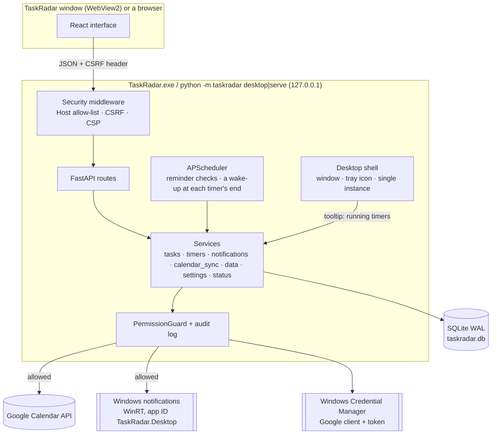

# TaskRadar architecture

TaskRadar is a single local process: a FastAPI application that serves a JSON API and the built React interface on
`127.0.0.1`, runs a background scheduler, and stores everything in one SQLite database under
`%LOCALAPPDATA%\TaskRadar`. Normally that process is the desktop app: a native window (Microsoft Edge WebView2)
shows the interface, a tray icon keeps TaskRadar reachable while the window is closed, and the server runs in a
thread of the same process; `taskradar serve` runs the same server for a browser instead. The only external service
is Google Calendar, reached through a guarded connector and only when the user connects it.

## Design principles

1. **Local first, least privilege.** Loopback-only HTTP, staged Google grants (app-created calendars, existing-calendar
   reads, then optional event writes). Only selected calendars are cached. Every external side effect passes one permission
   guard and is written to an audit log.
2. **Deterministic dates.** One-sentence to-dos are parsed by code in three languages. A date without a time stays
   date-only (never an invented 23:59); relative dates count from the moment of typing.
3. **The server owns the timers.** A Pomodoro phase or a countdown is a database row with an end time; the
   scheduler ends it on time and sends its notification, whether or not a page is open.
4. **Ask before anything lasting.** Deleting a task, writing to the calendar, autostart and the Start menu entry
   need an explicit confirmation; status changes and edits can be undone.

## Runtime view

Concurrency: SQLite allows one writer; requests run on uvicorn's thread pool, scheduled jobs on APScheduler's
threads. Reminder runs are recorded as jobs with a database lock, so overlapping runs are skipped. A timer is ended by
a conditional `UPDATE … WHERE status = 'running'`, so of the scheduler and a page reading the timers at the same
moment only one ends it (and notifies). A file lock keeps two servers off the same data folder.

## Modules

| Area | Module(s) | Responsibility |
| --- | --- | --- |
| One-sentence to-dos | `extraction/quick_add.py`, `extraction/dates.py`, `extraction/lexicon.py`, `parsing/language.py` | Dates and times in Chinese, German and English ("周五前", "nächsten Freitag", "by Oct 20 5pm"); a bare weekday means the next one; a time without a deadline word means an appointment; the date phrase is removed from the title |
| Tasks | `services/tasks.py`, `api/routes/tasks.py`, `api/serializers.py` | Creating, editing, status changes (to do, in progress, waiting for reply, done, dismissed) as revertible events, deleting (one or many), the dashboard (attention list by time, lanes by status), task views (`manual`, `in_calendar`) |
| Deadlines and reminders | `deadlines/engine.py`, `deadlines/reminders.py`, `services/notifications.py` | Effective deadline, urgency buckets, reminder planning with de-duplication, in-app notifications and Windows notifications |
| Timers | `services/timers.py`, `api/routes/timers.py`, `scheduler/service.py` | Pomodoro phases and countdowns, their end on time, notifications, the next phase |
| Windows notifications | `notify/windows.py`, `services/system.py` (`StartMenuEntry`) | WinRT toasts under TaskRadar's app ID; the Start menu entry Windows needs to show them on the screen |
| Google Calendar | `connectors/google_oauth.py`, `connectors/calendar.py`, `connectors/errors.py`, `services/calendar_sync.py` | OAuth (installed-app flow, PKCE), preview → confirm → write into the "TaskRadar" calendar, update in place, remove TaskRadar's own events |
| Settings, status, data | `services/settings.py`, `services/status_summary.py`, `services/data.py`, `services/jobs.py` | Typed settings sections, the plain-language status summary, export and deletion |
| Security | `security/permissions.py`, `security/secrets.py`, `security/redact.py`, `api/middleware.py` | The permission guard, the Credential Manager, log redaction, Host/CSRF/CSP checks |
| Desktop | `desktop/shell.py`, `desktop/tray.py`, `desktop/server.py`, `desktop/bridge.py`, `desktop/prefs.py`, `desktop/instance.py`, `desktop/splash.py`, `desktop/win32.py`, `desktop/install.py` | The window, the tray icon, the server thread, window placement, single instance, installing and uninstalling |

### Timers

Every Pomodoro phase (focus, short break, long break) is a row of its own in `timers`, so the finished focus sessions
are the day's history; a countdown is a row too (`mode` "duration" or "until"). A running timer has `ends_at`; a
paused one keeps `remaining_seconds` instead. Starting, pausing, resuming and stopping tell the scheduler: it adds a
date job `timer-<id>` at the end time (with no misfire limit, so a timer still ends after the computer slept) or
removes it.

At the end, `finish_due()` marks the timer finished, stores a notification (the bell list) and shows a Windows
notification if timer notifications are on. The Pomodoro set follows the usual rules: after focus session *n* a short
break, after the `long_break_every`-th a long one; after a short break focus session *n + 1*; after a long break, a
stop, or more than an hour without a phase a new set begins. "Skip" ends a phase without counting it and starts the
next; starting another phase while one runs skips the running one. A focus session that belongs to a to-do moves it
to "进行中" when the session starts, resumes or starts by itself (a recorded status change that can be undone; a task
in any other status keeps it). A countdown to a moment ends exactly at that
moment in the user's time zone and cannot be paused. On start-up `resume_schedule()` ends what ran out while
TaskRadar was not running (the notification says when it ended) and schedules the rest.

Each completed Pomodoro phase also publishes a process-local pending alarm, independently of Windows toast
settings. `GET /api/timers/alarm` exposes the pending completion on every page; a CSRF-protected dismissal
acknowledges its notification and clears only the matching alarm ID, so a late click cannot clear a newer phase.
Starting the next phase does not clear the alarm. Reloading or changing pages preserves it; quitting TaskRadar
ends the alarm. Completions found more than two minutes late remain visible but are not audible.
The desktop shell follows these changes, restores its window and uses `notify/alarm.py` to loop the Windows
alarm sound asynchronously until acknowledgement, sound being disabled, or app exit. Sound passes through the
`timer.alarm` permission check. The global `TimerAlarm` dialog polls for completion and provides Stop; browser
sessions use a gesture-unlocked Web Audio chime instead of native sound, avoiding duplicate desktop audio.

The page shows the timers but does not run them: `lib/timers.ts` counts down every second from the server's
`remaining_seconds`, so it never drifts from the server's clock, and asks the server again when a timer should have
ended. The tray icon's tooltip follows the timers through a listener of `TimerService` (a change wakes the shell's
thread at once; while a timer runs it refreshes every 10 s).

### Notifications

`notify/windows.py` shows notifications through the WinRT `ToastNotifier` with the app ID `TaskRadar.Desktop`,
registered under `HKCU\Software\Classes\AppUserModelId` with TaskRadar's name and icon (the window uses the same app
ID, so it groups with its Start menu entry in the taskbar). Notification text is XML-escaped data.

Windows shows an app's notifications on the screen only when a Start menu shortcut carries the app's
`System.AppUserModel.ID`; without one they go to the notification centre only. This was measured on the
development computer: with only the registry registration (also with a `CustomActivator` COM class) test
notifications did not appear on the screen, with a Start menu shortcut carrying the ID they did. Therefore the
installer writes the ID into its Start menu and desktop shortcuts (`install.create_shortcut(app_id=…)`), and
`StartMenuEntry` lets a source or portable run add `Programs\TaskRadar.lnk` with the ID after the user confirms
(`POST /api/system/start-menu`, guarded by `START_MENU_MODIFY`). It never replaces or removes an entry that starts
another TaskRadar (an installed one); an entry without the ID only gets the ID added. The status summary reports
`notification_banners_off` while notifications are wanted but Windows would not show them.

### Deadlines and reminders

Deadlines are stored as a local date, an optional `HH:MM` time, the IANA time zone (default Europe/Berlin) and a
precision (`none` / `date` / `datetime`). For urgency only, a date-only deadline counts until the end of that local
day; `zoneinfo` + `tzdata` handle daylight saving time. Buckets: overdue, ≤ 24 h, ≤ 3 days, ≤ 7 days (configurable).
Reminders have de-duplication keys (task, deadline version, bucket, repeat window for overdue) and stop for completed
or dismissed tasks. The reminder check runs on an interval and once shortly after start-up.

### Status changes and undo

Status changes and edits are `task_events` with before/after values; `/events/{id}/undo` reverts them, and the UI
offers "撤销" after each change. Dismissing keeps a task (it can be reopened); deleting removes the task with its
history after a confirmation, and its calendar event if the setting says so.

## Data model

| Table | Content |
| --- | --- |
| `tasks` | Title, description, category, priority, status, deadline fields, `manual` (the user's own to-dos), `sample` (test data) |
| `task_events` | History with before/after values and revert markers |
| `calendar_links` | Google event IDs, sync status and payload hash per task |
| `calendar_sources`, `google_events`, `calendar_windows` | Selected calendars and actual ACL hints; unexpanded incremental collections; separately fetched bounded instance snapshots |
| `work_blocks`, `calendar_drafts` | Independent local work plans with optional task/event links; durable explicit-submit outbox with base and conflicting remote versions |
| `timers` | Pomodoro phases and countdowns: kind, phase, mode, label, task, cycle, status, duration, time left, end time |
| `notifications` | In-app notifications (reminders, timer ends) with de-duplication keys and whether Windows showed them |
| `settings`, `sync_jobs`, `audit_log` | Typed settings sections, job runs (reminder checks), permission decisions |
| `sources`, `messages`, `documents`, `document_pages`, `task_sources`, `task_candidates`, `extraction_runs`, `task_suggestions`, `task_links`, `sync_checkpoints` | Data of earlier versions (imported mails and files and what was read from them); kept until the user deletes it (`POST /api/data/delete-imported`) |

Timestamps are stored as aware UTC values (a custom `UTCDateTime` type rejects naive datetimes). The schema is managed
by Alembic; migrations run automatically on start-up and with `python -m taskradar migrate`; a test checks that the
migrations build exactly the schema the models describe.

## API

All routes live under `/api` (OpenAPI docs at `/api/docs`): the dashboard and tasks (`/dashboard`, `/tasks` with
`status`, `manual` and `in_calendar` filters, `/tasks/quick-parse`, `/tasks/{id}/status`, `/tasks/batch` with
`delete`, `DELETE /tasks/{id}`, `/events/{id}/undo`, `/tasks/{id}/calendar/preview|remove`), timers (`/timers`,
`/timers/pomodoro`, `/timers/countdowns`, `/timers/{id}/pause|resume|skip|restart|cancel`, `/timers/clear-finished`),
integrations (`/integrations/google/*`, `/oauth/google/callback`) and the system (`/session`, `/system/status`,
`/system/summary`, `/settings`, `/notifications`, `/data/export`, `/data/legacy`, `/data/delete-imported`,
`/data/delete-all`, `/system/autostart`, `/system/start-menu`, and `/desktop/state|activate` in the desktop app).
Errors use one envelope: `{"error": {"code", "message", "recoverable", "details"}}`; the UI translates the codes.
Changes answer with what the UI shows next (a task with its `undo_event_id`, or all timers).

## Frontend

React 19 + TypeScript, Vite, Tailwind CSS v4, Radix UI primitives, TanStack Query, react-router and i18next (zh-CN
default, English). `src/lib/api.ts` adds the CSRF token (fetched from `/api/session`, refreshed once if the server
restarted) and maps the error envelope; `src/lib/queries.ts` wraps every change so errors always surface as toasts
(with "撤销" when the response names an undo event) and the visible data is refreshed.

Pages: Today (what needs attention by time, the board by status, recently completed), the task views (全部任务, 我创建的,
Google 日历, each with status tabs), a task's page, 番茄钟, 倒计时 and the settings (one section at a time: 常规, 入门指南,
提醒与通知, 番茄钟与倒计时, Google 日历, 数据与隐私, 系统与高级选项; unsaved edits are protected on every way out). The
sidebar groups the views and the timers and shows a running timer's time; the top bar has "添加待办", the search, the
status icon and the notifications.

Colours, type, sizes and motion come from tokens in `src/index.css` (light and `.dark`): a light frame holds the
sidebar and the top bar, the page sits on one work surface; indigo marks the one main action of a page, red overdue
and destructive actions, amber warnings, green done, blue "in progress", violet "waiting for reply". Segoe UI
Variable with Microsoft YaHei UI; 32 px controls; short motion that `prefers-reduced-motion` switches off.
`npm run build` writes the bundle into `backend/src/taskradar/static`, which the backend serves (no external CDN;
strict CSP).

## Desktop app

`taskradar desktop` (the default of the packaged program) is the server plus a window and a tray icon in one process
(`taskradar/desktop/`):

* **Start** (`shell.run`). Per-monitor DPI awareness; one TaskRadar per data folder through the folder's file lock. A
  second start asks the running one to show its window (`POST /api/desktop/activate`), also out of the tray; when the
  folder is used by `taskradar serve`, it offers to open that in the browser. `--minimized` (autostart) starts in the
  tray. Without the WebView2 runtime it says so and offers Microsoft's download page.
* **Server** (`server.BackgroundServer`): the same container and FastAPI app as `serve`, run by uvicorn in a thread;
  the window shows a small start page until the server answers, then loads the app.
* **Window** (pywebview on WebView2, WinForms): size, position and maximised state restored when still on a screen;
  the native title bar in the page's colours. Only the app's own address loads in the window; other links open in the
  default browser; going back never returns to the start page.
* **Tray** (`tray.Tray`, a WinForms `NotifyIcon`): closing the window hides it (unless the user switched that off);
  the first time, a notification says where TaskRadar went. A click opens the window; the menu opens it or quits,
  asking first about unsaved changes, which the page reports through `PUT /api/desktop/state`.
* **Close.** Window geometry is saved, the tray icon removed, the server shut down and the process ended.
* `TASKRADAR_WEBVIEW_DEBUG_PORT` opens WebView2's DevTools port for automated checks only
  (`scripts/desktop-check`); it is never set by the app.

**Installing** (`packaging/installer.py`, `taskradar/desktop/install.py`). `TaskRadar-Setup-<version>.exe` installs for
the current user into `%LOCALAPPDATA%\Programs\TaskRadar`: it refuses a non-empty folder it did not create, checks
that every archive member stays inside the folder and swaps in the new version. It creates the Start menu and,
optionally, the desktop shortcut (both with TaskRadar's app ID) and the entry in Settings → Apps. `TaskRadar.exe
uninstall` removes only what the installer created (shortcuts pointing into the program folder, its registry entry,
TaskRadar's own autostart entry and notification registration) and keeps data and secrets.

## Packaging

`packaging/taskradar.spec` builds the windowed TaskRadar.exe with PyInstaller (`scripts\build-exe.ps1` also builds
the web UI, zips the portable folder and builds the installer around it). The web UI, the migrations and the icons
are packed where the code finds them through `__file__`; of the Google client's discovery documents only Calendar's
is kept; the WinRT bindings for notifications are included; Pillow (a development tool here) is left out.

## Decisions and trade-offs

### Calendar workspace

`services/calendar_workspace.py` provides the local-first read model, per-calendar cache sync and safe task mappings;
`services/calendar_editor.py` owns durable drafts, permission checks and conditional mutations. Both reuse the existing
OAuth manager, Credential Manager, permission audit, JobRunner and APScheduler. Legacy task mirroring shares the same
mutation lock. Cache reads do not wait for Google network operations.

Collection sync uses unexpanded events with a syncToken and no date bounds. Visible windows use a separate bounded
expanded query without a syncToken, so Google owns recurrence and exceptions. Each paginated snapshot is replaced only
after all pages arrive; 410 rebuilds only that calendar's remote collection. Tasks, work plans and pending drafts survive.
Writes use stable event IDs on creation and ETag If-Match on edits/deletions. The frontend never handles Google tokens.

FullCalendar Standard 6.x (MIT), with Luxon named-time-zone support, is loaded on demand. Details of field mappings,
deletion rules, grants, scope limitations and component selection are in [the calendar guide](docs/CALENDAR_WORKSPACE.zh-CN.md).

* **A plain to-do app instead of automatic extraction.** Reading mails and documents produced tasks that needed a
  review queue and could merge unrelated mails; writing a to-do in one sentence is fast and always right.
* **Timers in the server.** They must end on time while the window is hidden; the page only shows them.
* **The Start menu entry only on request** (outside the installer): it is a visible change to the user's Start menu.
* **SQLite** – single user, zero setup, transactional, easy to back up and delete.
* **No automatic calendar writes by default** – calendars may be shared; writes need a preview and a click (an
  opt-in rule exists per category).
* **Credential Manager instead of files** – tokens never sit in the project folder or the database.

## Testing strategy

* Backend (pytest, a fixed clock): dates and one-sentence to-dos, the task lifecycle and undo, deleting, the
  dashboard, reminders and daylight saving time, timers (the Pomodoro set, pause/resume, skip, automatic starts,
  countdowns for a duration and to a moment, ending once when callers race, notifications on and off, ends while
  TaskRadar was not running, the real scheduler ending a countdown on time), the Calendar with a fake client, the
  security checks (CSRF, Host, Origin, permission guard, redaction), the status summary, migrations, and the desktop
  pieces (window placement, the tray's texts, single instance, installing for real into temporary folders with a test
  registry key, the Start menu entry with its app ID in a temporary folder).
* Frontend (Vitest + Testing Library): formatting and time zones, the API client, translations (both languages must
  have the same keys), the dashboard, the task list, the status menu and deleting, the settings (unsaved edits, the
  timer settings, the notification banner check), the Pomodoro and countdown pages and the sidebar's live times.
* `scripts/desktop-check/flow.mjs` drives the real window through the main flow (add to-dos, start one, delete one,
  complete one, the Pomodoro timer, a countdown that ends with a notification, the guide).
