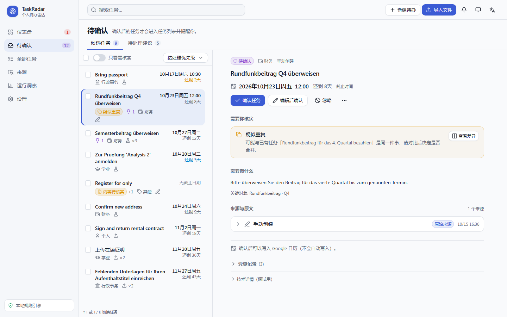
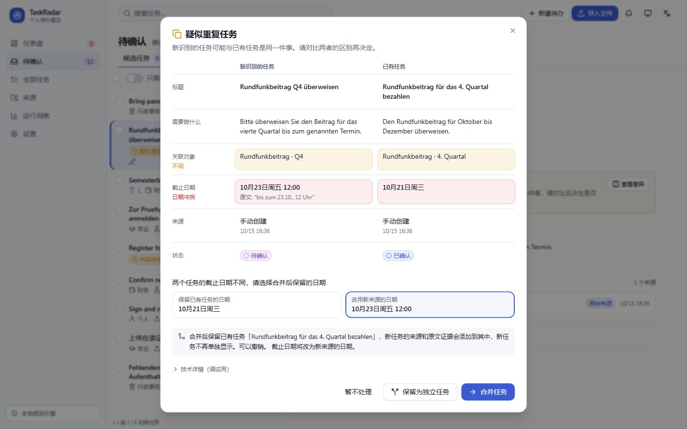
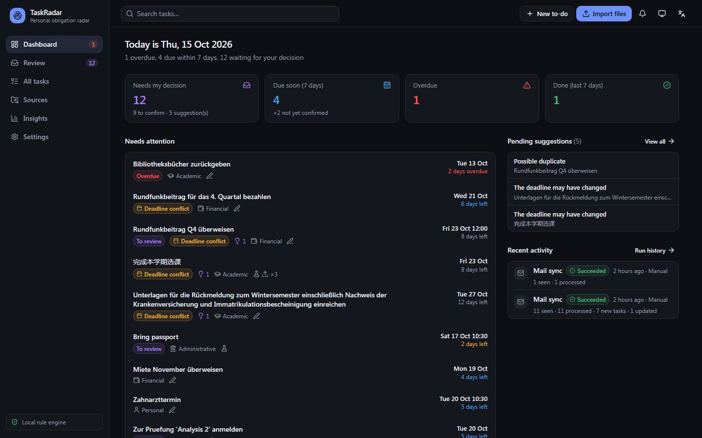
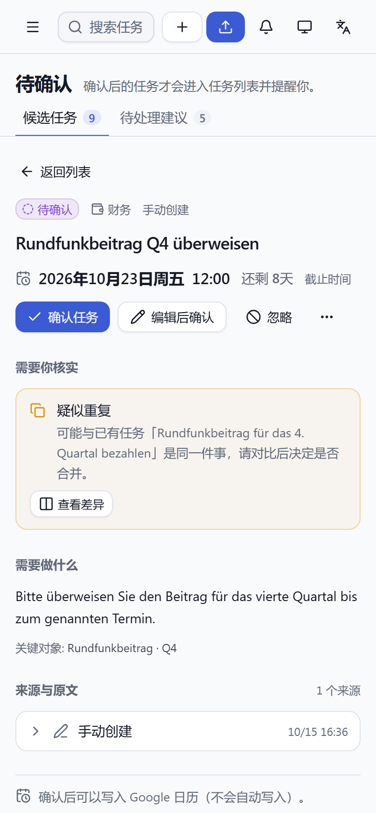
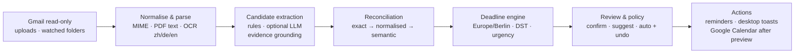

# TaskRadar — personal obligation radar

TaskRadar is a local agent for Windows. It reads your e-mail (Gmail, read-only), PDFs and screenshots,
finds what you have to do and by when, shows you the sentence it based that on, and reminds you once you
have confirmed the task. Everything runs on your own computer at `http://127.0.0.1:8000`.

> 中文简介见下方 [中文快速上手](#中文快速上手)。The UI is Chinese by default and switchable to English.



| Possible duplicate: compare, choose the date, merge or keep both | Dashboard (dark, English) | Phone |
| --- | --- | --- |
|  |  |  |

All screenshots show synthetic data (demo mailbox, bundled samples, invented tasks); more in
[docs/screenshots](docs/screenshots).

---

## The problem

Obligations arrive scattered over many channels and languages: a university office asks you to upload an
enrollment certificate "by 20 November", the immigration office sends a German letter as a scan, the
landlord writes "nächsten Freitag", a reminder repeats the first mail, and a payment confirmation means the
task is done. Mail clients show *unread*, not *undone*. Calendars only contain what you typed in yourself.

## Why an agent (and which kind)

The job is a pipeline of judgements, not a single classification: Is this an obligation or marketing? What
exactly must be done? Is "next Friday" relative to today or to the letter's date? Is this mail a reminder of
something already known, a deadline change, or proof that it is done? Should that be applied automatically
or asked?

TaskRadar is therefore a **single, tool-using agent with a human in the loop**, deliberately not a swarm of
LLM agents:

* deterministic parsers do what they are good at (MIME, PDF text, OCR, dates in zh/de/en, time zones);
* a rule-based extractor works offline; an optional LLM (OpenAI or any OpenAI-compatible endpoint) improves
  extraction on hard text, always validated against the source (evidence grounding, date re-parsing);
* a three-layer reconciler decides *new / duplicate / deadline update / completion / unsure*;
* a policy layer decides what may be applied automatically (and makes it undoable) and what must be
  confirmed by you. Nothing with an external side effect happens without your explicit action.

## How it works



Every automatic change is written to the task's history and can be undone; every task links back to the
mail or document and quotes the sentence it came from. Details: [ARCHITECTURE.md](ARCHITECTURE.md).

## Features

| Area | What it does | Status |
| --- | --- | --- |
| Your own to-dos | "New to-do" on every page; one-line quick entry in zh/de/en ("周五前交房租", "Freitag 10 Uhr Zahnarzt", "submit report by Oct 20 5pm"): title, date, time and kind are recognised locally and shown for review before saving; reminders and calendar like any other task | implemented, tested, verified in a browser |
| Uploads & folders | PDF, PNG, JPG, WebP, `.eml`; drag & drop; only folders you add are watched; originals are never modified | implemented, tested |
| Parsing | text-first PDF extraction, OCR fallback per page (Tesseract, `chi_sim+eng`, `deu+eng`), MIME/HTML mail, quoted-reply stripping; files imported before OCR was installed can be read again from the Sources page | implemented, tested (real OCR in tests) |
| Extraction | tasks with title, action, category, priority, deadline (date-only stays date-only), confidence, evidence; marketing/newsletters ignored; prompt-injection text treated as data | implemented, tested, evaluated |
| Dates | absolute, relative and ambiguous dates in zh/de/en; relative dates resolved from the *source* date; unresolvable dates are flagged, never invented | implemented, tested |
| Deduplication | same source / same thread, normalised similarity across languages, optional LLM judge; grey zone becomes a suggestion that you review side by side ("merge / keep separate / not now"); when the deadlines differ you choose the date that stays; every decision is undoable | implemented, tested, evaluated |
| Lifecycle | Candidate → Confirmed → In progress / Waiting for reply → Completed / Dismissed; completion evidence; explicit deadline changes applied with undo | implemented, tested |
| Reminders | Overdue / 24 h / 3 days / 7 days (configurable), date-only deadlines count until the end of the day, DST-safe, deduplicated, stop after completion | implemented, tested |
| Gmail | OAuth (installed-app flow with PKCE), `gmail.readonly` only, last 30 days, incremental history sync, request pacing, retries with backoff, attachments | implemented, tested with a fake Gmail; **verified with one real account**: initial and incremental sync, attachments, automatic recovery from Google's rate limit (request pacing was added afterwards and is tested with fakes only) |
| Google Calendar | separate OAuth (`calendar.app.created`), preview → confirm → write into a dedicated "TaskRadar" calendar, idempotent event IDs, no invitations | implemented, tested with a fake Calendar; **verified with one real account**: calendar created, all-day deadline written, updated in place after a date change (same event, no duplicate), unchanged re-write skipped; a disabled Calendar API is explained with Google's enable link. Events can be removed again (button, or automatically when a task is dismissed, merged or deleted - a setting, on by default); only TaskRadar's own events are ever deleted. Removal with the button verified with the real account; the automatic removal is tested with a fake Calendar |
| LLM extraction | OpenAI structured outputs or OpenAI-compatible endpoint, strict schema validation, bounded retries, rules fallback, data minimisation, consent required | implemented, tested with a mocked provider; **real API not verified** (needs your key) |
| User interface | Dashboard (what needs attention, unconfirmed tasks always marked), Review inbox (list + detail, sorted by what needs handling first, problems in plain language, keyboard navigation), All tasks, Task detail (deadline, open questions, quotes per source, calendar, history), Sources (connected sources + processing records with reasons), Insights (system status, processing figures with their basis), Settings (one category at a time); undo after every decision; one scroll area, layouts from 390 px phones to desktops; dark/light; zh/en | implemented, unit-tested, verified in a browser at 1440 / 1024 / 768 / 390 px, light and dark, Chinese and English |
| Background | scheduled Gmail sync, folder scans, reminder checks, automatic retries, restart recovery, optional Windows autostart (only after confirmation) | implemented, tested |
| Data control | export as JSON, delete single items, delete everything (typed confirmation) | implemented, tested |

## Quick start (Windows 10/11)

Requirements: **Python 3.12+**, **Node.js 20+** (only to build the web UI) and, for scans/screenshots,
**7-Zip** (used once to unpack the OCR engine). No administrator rights are needed.

1. **Set up** — double-click `Setup.cmd` (or run
   `powershell -ExecutionPolicy Bypass -File scripts\setup.ps1`). It creates `backend\.venv`, builds the web
   UI and prepares the database in `%LOCALAPPDATA%\TaskRadar`.
2. **OCR (recommended)** — the setup asks whether to install it; you can also run
   `powershell -ExecutionPolicy Bypass -File scripts\install-tesseract.ps1` at any time. It downloads Tesseract
   5.4 (UB Mannheim build) plus the German and Chinese models, verifies pinned SHA-256 checksums and unpacks them
   into `%LOCALAPPDATA%\TaskRadar\tools\tesseract`.
3. **Start** — double-click `TaskRadar.cmd`. The dashboard opens at <http://127.0.0.1:8000>; closing the
   window stops the server. `scripts\start.ps1 -Background` starts it without a window.

### Try it without any account

* **Sources → Demo mailbox → Create**: 11 synthetic mails (Chinese, German, English) with a fee request and
  its reminder, a deadline extension, an appointment, marketing, a newsletter and a prompt-injection attempt.
  "Deliver follow-up mail" sends a payment confirmation to show automatic completion and undo; the
  failure-mode selector simulates rate limits, server errors, expired authorization and network outages.
* **Import files**: the synthetic sample documents in `backend/src/taskradar/demo/samples/` (Chinese PDF,
  German screenshots, a scanned PDF, an English contract, a marketing flyer). Drop them onto the window.
  `backend\.venv\Scripts\python.exe -m taskradar demo-files <folder>` writes fresh copies.

## Connecting Gmail and Google Calendar

These are the only steps that require you personally. TaskRadar never sees your Google password, and only
asks for read-only Gmail access and for calendars it creates itself.

1. Open the [Google Cloud Console](https://console.cloud.google.com/) and create a project (e.g. "TaskRadar").
2. *APIs & Services → Library*: enable the **Gmail API** and, if you want calendar entries, the
   **Google Calendar API** (connecting works without it, but writing an event then fails; the calendar
   dialog links to the switch).
3. *OAuth consent screen*: user type **External**, publishing status **Testing**, add your own Google account
   under **Test users**. Scopes: `.../auth/gmail.readonly` and `.../auth/calendar.app.created`.
4. *Credentials → Create credentials → OAuth client ID*, application type **Desktop app**. Download the JSON.
5. In TaskRadar: **Settings → Gmail → Upload client JSON**, then **Connect Gmail (read-only)**. Google's
   consent page opens; sign in and approve. You are redirected back to
   `http://127.0.0.1:8000/api/oauth/google/callback` and the first sync (last 30 days) starts.
6. Optional: **Settings → Google Calendar → Connect Google Calendar**. Tasks are written only after you open
   a task, check the preview and press **Confirm & write**.

Notes: the client JSON and the tokens are stored in the Windows Credential Manager, not in files. While
the Google project is in *Testing* status, Google expires refresh tokens after 7 days; TaskRadar then shows
"re-authorization needed" and keeps all data until you reconnect. Disconnecting revokes the token.

## Optional: LLM-assisted extraction

The default is the local rule engine: no API key, no data leaves the computer. In **Settings → Extraction**
you can choose **OpenAI** or an **OpenAI-compatible endpoint** (e.g. a local server), pick the model (not
hard-coded; default `gpt-5-mini`) and store the key in the Windows Credential Manager. Before any content is
sent to a cloud provider you must tick the data notice. Data minimisation is on by default: only content that
looks like it contains obligations is sent, IBANs/card numbers/ID numbers/phone numbers/mail user names are
masked, long texts are truncated, and the model output is checked against the source text. If the model
fails or returns invalid JSON, TaskRadar falls back to the rule engine.

## Privacy and permission model

* Binds to `127.0.0.1` only; Host-header allow-list against DNS rebinding; per-process CSRF token plus
  Origin/`Sec-Fetch-Site` checks on every state-changing request; strict Content-Security-Policy.
* Every external side effect (LLM request, Gmail read, calendar write, autostart, desktop notification,
  opening Explorer, deleting all data, …) goes through one permission guard and is written to an audit log.
* Mail and document text is treated as untrusted data: prompt-injection phrases are detected and flagged,
  command-like "tasks" are dropped, and nothing is ever executed from content.
* Uploads are size-limited and identified by magic bytes; file names are sanitised; files are served only
  from TaskRadar's storage or folders you added; whole drives, your profile root and system folders cannot
  be watched.
* Secrets never go to the database, the logs (a redaction filter masks tokens and keys) or Git.

See [SECURITY.md](SECURITY.md) for the threat model.

## Tests and quality

```powershell
cd backend
.venv\Scripts\python.exe -m pytest            # 233 tests, about 30 s, includes real OCR
.venv\Scripts\python.exe -m ruff check .
.venv\Scripts\python.exe -m ruff format --check .
.venv\Scripts\python.exe -m mypy
.venv\Scripts\python.exe -m taskradar eval    # extraction / dedup evaluation on the labelled dataset

cd ..\frontend
npm run lint; npm run typecheck; npm test      # 62 tests
```

The workflow in `.github/workflows/ci.yml` runs the same checks on Ubuntu, with Tesseract and the same pinned
language models. It has not run on GitHub yet (the repository has not been pushed); the backend checks were run
locally on Windows 11 and on Ubuntu 24.04 (WSL), where the four OCR tests were skipped for lack of Tesseract.

### Evaluation (rule engine, `rules-1.5`)

Measured with `python -m taskradar eval` on synthetic, hand-labelled cases. The development set was used while
building the rules; the held-out set was written separately and run without tuning on it (one bug it exposed,
an invented date for "within 14 days after signing", was fixed afterwards, and one case improved as a side
effect of a later fix — see [docs/EVALUATION.md](docs/EVALUATION.md)).

| Metric | Development set (36 cases) | Held-out set (30 cases) |
| --- | --- | --- |
| Task precision / recall / F1 | 1.00 / 1.00 / 1.00 | 1.00 / 0.78 / 0.88 |
| Deadline date correct | 21/21 | 13/13 |
| Deadline time correct | 21/21 | 12/13 |
| Marketing/info cases with false tasks | 0/7 | 0/7 |
| Correct merges / wrong merges | 5/5 / 0 | 1/1 / 0 |
| Completion evidence detected | 6/6 | 3/5 |

The held-out recall shows the honest limit of hand-written rules on unseen phrasing; that is what the optional
LLM path is for (not yet measured against a real model).

### Performance (measured)

On an AMD Ryzen 9 7940H laptop (Windows 11, Tesseract 5.4), importing the seven sample documents through the
full pipeline (parsing, OCR, extraction, reconciliation, storage), three runs on fresh databases:

| Input | Time per document (median of 3) |
| --- | --- |
| Text PDF (Chinese / English) | 97 ms / 45 ms |
| Screenshot, OCR (German / Chinese) | 0.40 – 0.99 s |
| Scanned PDF, OCR (Chinese) | 1.19 s |
| All seven samples | 3.8 – 4.1 s total |

Result: 4 tasks, 2 reminder screenshots merged into existing tasks, the marketing flyer ignored.

## Project layout

```
backend/            FastAPI app, agent pipeline, SQLite + Alembic, tests  (Python package `taskradar`)
  src/taskradar/    api · parsing · extraction · llm · reconciliation · deadlines · policy · services
                    connectors (Gmail, Calendar, OAuth) · scheduler · security · demo · migrations
frontend/           React + TypeScript + Tailwind dashboard (built into backend/src/taskradar/static)
scripts/            setup.ps1 · start.ps1 · install-tesseract.ps1
docs/               EVALUATION.md · screenshots/
TaskRadar.cmd       double-click launcher       Setup.cmd   one-time setup
```

## Limitations

* The rule engine misses phrasings it has not seen (held-out recall 0.78), e.g. library loans
  ("归还/续借"), parcel pick-ups ("abholen"), passive bookings ("must be booked") and some completion phrasings
  ("has been confirmed", "was submitted successfully"). Titles can be vague when the instruction uses a pronoun
  ("Diese hochladen"); the evidence quote still shows the full context.
* Gmail sync and calendar writing have been exercised with one real account. The OpenAI path is implemented
  against the official API and covered by tests with a mocked provider, but has **not** been exercised with a
  real API key yet.
* "Delete all data" removes local data only; events already in the "TaskRadar" calendar stay there (remove that
  calendar in Google Calendar if you want them gone).
* Desktop toasts use Windows PowerShell/WinRT and depend on the Windows notification settings (there is a test
  button); autostart, Explorer integration and toasts are Windows-only.
* OCR covers printed Chinese (simplified), German and English; handwriting and low-quality photos are not
  reliable. Low OCR confidence is flagged for review.
* Recurring obligations are recognised as "related", not modelled as series. Single user, no mobile sync.
* The local database is not encrypted by TaskRadar; it relies on your Windows account (BitLocker recommended).

## Roadmap

* Measure the LLM path on the held-out set with a real model and a local OpenAI-compatible model.
* Learn from corrections (user edits and dismissals as few-shot examples / rule suggestions).
* IMAP and Outlook connectors; recurring obligations; a signed one-click installer.
* Optional encryption of the local database.

## 中文快速上手

1. 安装 Python 3.12+ 和 Node.js 20+；如需识别扫描件/截图，再安装 7-Zip。
2. 双击 `Setup.cmd` 完成一次性安装（无需管理员权限）。安装过程中会询问是否下载 OCR 引擎（约 110 MB，会校验 SHA-256），
   也可以之后运行 `powershell -ExecutionPolicy Bypass -File scripts\install-tesseract.ps1`。
3. 双击 `TaskRadar.cmd` 启动，浏览器打开 <http://127.0.0.1:8000>。关闭窗口即停止。
4. 不连接任何账号也能体验：「来源 → 演示邮箱 → 创建」，或把 `backend/src/taskradar/demo/samples/` 中的示例文件拖进窗口。
   如果在安装 OCR 之前就已导入截图或扫描件，装好 OCR 后在「来源」页点「立即识别」即可补识别，无需重启。
5. 连接 Gmail / Google 日历需要你本人在 Google Cloud Console 创建“桌面应用”OAuth 客户端并登录授权，并在
   「API 和服务 → 库」中启用 Gmail API；要写入日历，还需启用 Google Calendar API。步骤见上文
   [Connecting Gmail and Google Calendar](#connecting-gmail-and-google-calendar)。Gmail 只申请只读权限。
6. 默认使用本地规则引擎，不会把内容发给任何云服务；启用 OpenAI 前需要在设置中明确同意数据发送说明。
7. 自己的待办：任意页面右上角「新建待办」，在「快速输入」里写一句话即可，例如“周五前交房租”“明天下午3点开组会”，
   日期和时间会自动识别并显示出来，确认后再保存。自己的待办同样有提醒，也可以写入或移出日历。

## License

[MIT](LICENSE)
