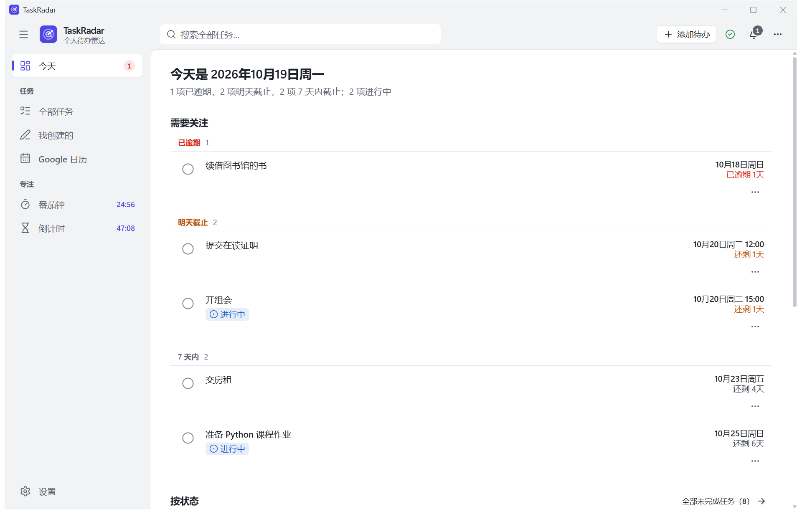
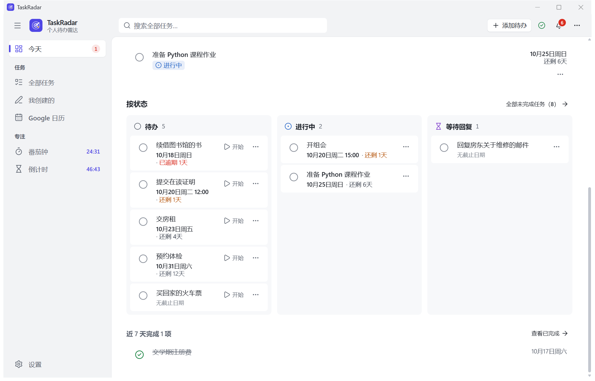
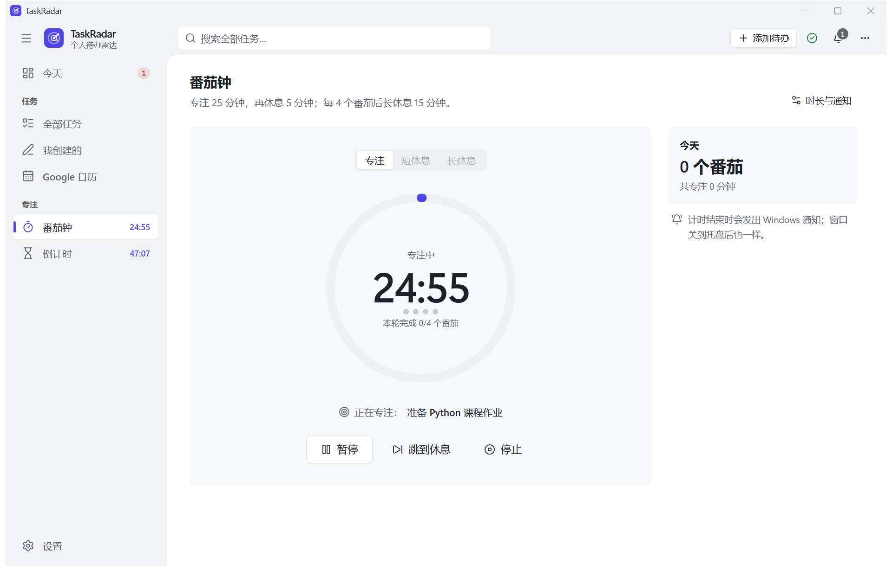
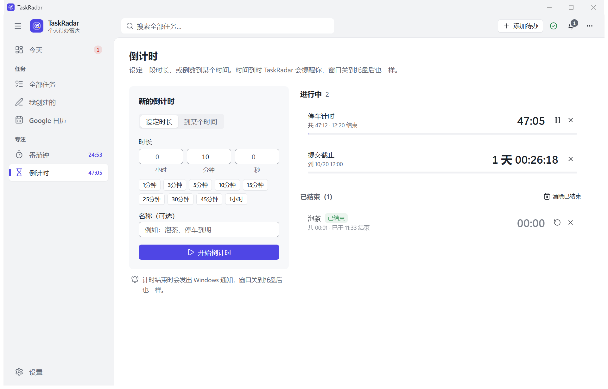
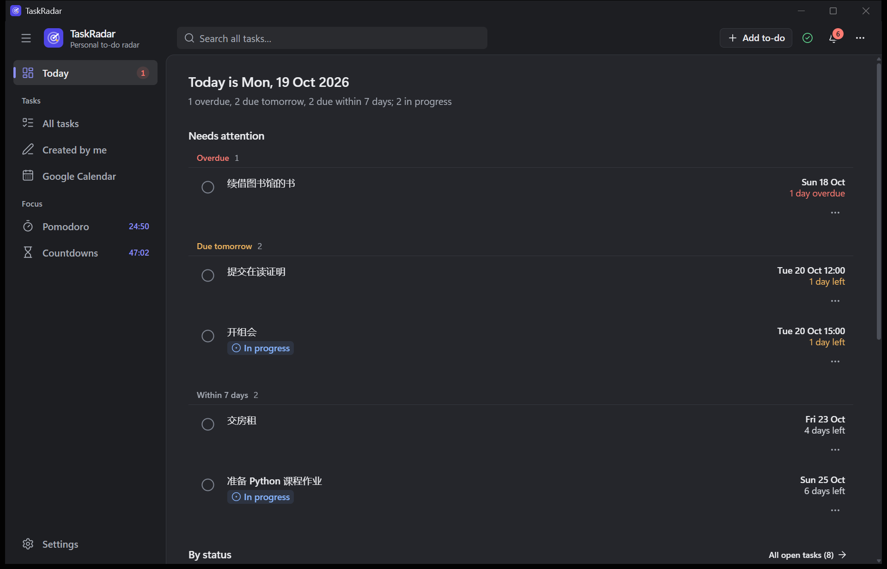

# TaskRadar — a local to-do app for Windows

[](https://github.com/HappyOwl-Wen/Taskradar/actions/workflows/ci.yml)

[](LICENSE)

TaskRadar is a to-do app for Windows that keeps everything on your own computer. You write a to-do as one sentence
("周五前交房租", "Freitag 10 Uhr Zahnarzt", "submit report by Oct 20 5pm") and the date and time are recognised
locally. Tasks move through *to do → in progress → waiting for reply → done*, and the home page shows them by status.
A Pomodoro timer and countdowns run in the sidebar; reminders and timers announce themselves with Windows
notifications, also while the window is closed to the tray. Tasks with a date can go into TaskRadar's own Google
calendar if you connect one.

> 中文简介见下方 [中文快速上手](#中文快速上手)。The UI is Chinese by default and switchable to English.



| The board by status | Pomodoro | Countdowns | Dark, English |
| --- | --- | --- | --- |
|  |  |  |  |

All screenshots show invented tasks in a test data folder; more in [docs/screenshots](docs/screenshots).

---

## What changed in this version

Earlier versions read Gmail, imported PDFs and screenshots and extracted tasks from them automatically, with a
"To confirm" queue for what they found. That reading was not reliable enough: unrelated mails could end up as one
task. This version is a plain to-do app instead:

* **Removed:** reading Gmail, importing files (with OCR), the demo mailbox, watched folders, the "To confirm"
  queue, automatic merging, and the optional LLM extraction.
* **Kept:** your tasks, including the ones earlier versions found (listed under "全部任务" with the quotes they
  were found by), and Google Calendar. The mails and files earlier versions imported, and the old Gmail sign-in
  and API key, stay until you delete them in Settings → 数据与隐私 (nothing is deleted automatically).
* **New:** the board by status on the home page, deleting tasks, task views in the sidebar, the Pomodoro timer,
  countdowns, the tray icon, Windows notifications for timers, a status icon in the top bar, and the guide in the
  settings.

## Features

| Area | What it does | Status |
| --- | --- | --- |
| To-dos in one sentence | "添加待办" on every page: one sentence in Chinese, German or English; the date and time are recognised locally and shown in editable fields before saving (relative dates count from the moment of typing; a date without a time stays date-only). Category, priority and notes wait under "更多选项" | implemented, tested, verified in the desktop window |
| Statuses you can see | To do, in progress, waiting for reply, done, dismissed. The home page lists what is overdue or due soon (with each task's status) and below it a board with one lane per status; "开始" moves a to-do to "进行中" in one click; every list shows the status of tasks that are not plain to-dos | implemented, tested, verified in the desktop window |
| Deleting | "删除任务…" in every task's menu and for a selection of tasks, after a question that says what happens (gone for good, unlike "忽略"); the task's Google Calendar event goes too (a setting) | implemented, tested, verified in the desktop window |
| Views in the sidebar | 全部任务, 我创建的 (your own to-dos) and Google 日历 (tasks with an event in TaskRadar's calendar), each with the tabs open / to do / in progress / waiting / done / dismissed / all | implemented, tested |
| Pomodoro | Focus 25 min, short break 5 min, a long break of 15 min after 4 Pomodoros (all adjustable); pause, resume, skip to the next phase, stop; breaks and focus sessions can start by themselves; a focus session can be linked to a task, and a to-do it is linked to moves to "进行中"; today's count; the sidebar shows the time left | implemented, tested, verified in the desktop window |
| Countdowns | For a duration (presets from 1 minute to 1 hour, or hours/minutes/seconds; can be paused and run again) or until a moment in your time zone; several at once; the sidebar shows the one that ends first | implemented, tested; a 5-second and a 3-second countdown ended on their own in the desktop window with their notification |
| Windows notifications | Timers and reminders announce themselves with a Windows notification under TaskRadar's own name and icon, also with the window in the tray (a timer runs in TaskRadar's background service, not in the page). A timer that ended while TaskRadar was not running is announced at the next start with its end time. Each kind can be switched off | implemented, tested. **Windows shows them on the screen only when TaskRadar is in the Start menu** (see [below](#notifications-on-the-screen)); measured on this computer: without such an entry 9 of 10 test notifications went only to the notification centre (the one that appeared came right after a test with an entry); with one, 5 of 5 appeared on the screen, and so did the notification of a 3-second countdown |
| Tray | Closing the window keeps TaskRadar in the notification area (switchable in Settings → 常规): click the icon to open the window, right-click to quit (asking about unsaved changes first). The icon's tooltip shows a running timer ("专注中 · 剩 25 分钟 · 1 个倒计时"). Starting TaskRadar again brings the window out of the tray | implemented, tested, verified in the desktop window (the tooltip read through UI Automation) |
| Reminders | Overdue, due within 24 hours, 3 days or 7 days (configurable); a date-only deadline counts until the end of that day; daylight saving time is handled; each reminder once, none after completion | implemented, tested |
| Status at a glance | An icon in the top bar is green while everything works; otherwise it says what needs attention and where to fix it (calendar events that failed, reminder checks that fail, background service stopped, notifications that Windows will not show) | implemented, tested |
| Calendar workspace | Month, week and agenda views for local deadlines, work blocks and selected Google calendars; cached multi-calendar reads, staged OAuth permissions, ordinary event editing, drafts, ETag conflicts and linked-task de-duplication | implemented with Fake Calendar tests; see [calendar guide](docs/CALENDAR_WORKSPACE.zh-CN.md) and [verification](docs/CALENDAR_VERIFICATION.zh-CN.md); real account authorization needs user validation |
| Data control | Export everything as JSON; delete single tasks; delete what earlier versions imported; delete all data (typed confirmation) | implemented, tested |
| Desktop app | Its own window (Microsoft Edge WebView2 through pywebview), its local service on `127.0.0.1` only; size and position remembered; light and dark; Chinese and English; optional start with Windows (into the tray). `TaskRadar-Setup-<version>.exe` installs for your account without administrator rights and adds TaskRadar to the Start menu; uninstalling keeps your data. Also a portable zip | the program built from this version answered on its local address 3.5 s after starting with a new data folder and 2.1 s after starting again (one measurement each, on this computer); the folder build is 55.7 MB. Not code-signed; not tested on Windows 10 or on another computer |

## Install the desktop app

Run `TaskRadar-Setup-<version>.exe` (built with `scripts\build-exe.ps1`, see
[below](#build-the-desktop-app-and-its-installer)). It shows where TaskRadar goes
(`%LOCALAPPDATA%\Programs\TaskRadar`, for your account only, no administrator rights), creates a Start menu entry
(which also lets Windows show TaskRadar's notifications on the screen) and, if you leave the box ticked, a desktop
shortcut, and adds TaskRadar to **Settings → Apps → Installed apps**, where you can uninstall it again (your data
stays). Running a newer setup updates an installed version (quit TaskRadar first). The program is not code-signed,
so Windows SmartScreen may ask on the first start ("More info" → "Run anyway"). It needs the Microsoft Edge WebView2
Runtime, which is part of Windows 11 (if it is missing, TaskRadar says so and offers Microsoft's download page).

Then open **TaskRadar** from the Start menu. Closing the window keeps TaskRadar running in the tray, so reminders
and timers go on; right-click its icon and choose "退出 TaskRadar" to end it.

### Notifications on the screen

Windows shows an app's notifications as banners only when a Start menu entry stands for the app; otherwise they go
to the notification centre without appearing on the screen. The installer creates that entry. When you run
TaskRadar from source or as the portable version, **Settings → 提醒与通知** says whether Windows will show the
notifications and offers "添加到开始菜单": after your confirmation it creates a "TaskRadar" shortcut in your Start
menu (for your account, no administrator rights), which you can remove there again.

## Quick start from source (Windows 10/11)

Requirements: **Python 3.12+** and **Node.js 20+** (only to build the web UI). No administrator rights are needed.

1. **Set up** — double-click `Setup.cmd` (or run `powershell -ExecutionPolicy Bypass -File scripts\setup.ps1`). It
   creates `backend\.venv`, builds the web UI and prepares the database in `%LOCALAPPDATA%\TaskRadar`.
2. **Start** — double-click `TaskRadar.cmd`. TaskRadar opens in its own window (the same window as the installed
   app). `TaskRadar.cmd --browser` starts the browser version instead (<http://127.0.0.1:8000>, stopped by closing
   its console window).
3. **Notifications on the screen** — see [above](#notifications-on-the-screen).

### Build the desktop app and its installer

```powershell
powershell -ExecutionPolicy Bypass -File scripts\build-exe.ps1
```

needs the setup above once and builds, with PyInstaller, a program that runs without Python or Node.js:
`dist\TaskRadar-Setup-<version>.exe` (the installer; `--silent` installs without asking),
`dist\TaskRadar-<version>-windows-x64.zip` (the portable version: unzip and double-click `TaskRadar.exe`) and, with
`-OneFile`, a single `dist\onefile\TaskRadar.exe`. The program keeps its data where the source version does
(`%LOCALAPPDATA%\TaskRadar`), so both can be used in turn, one at a time. Nothing personal is packed (no data, no
`.env`, no tokens).

[scripts/desktop-check](scripts/desktop-check) drives the real window through the main flow (add to-dos, start
one, delete one, complete one, the Pomodoro timer, a countdown, the guide) and saves screenshots; see its read-me.

## Connecting Google Calendar (optional)

These steps need you personally; TaskRadar never sees your Google password. The original permission is limited to
app-created calendars; reading and editing existing calendars require separate, explicit upgrades in Settings.

1. Open the [Google Cloud Console](https://console.cloud.google.com/) and create a project (e.g. "TaskRadar").
2. *APIs & Services → Library*: enable the **Google Calendar API**.
3. *OAuth consent screen*: user type **External**, publishing status **Testing**, add your own Google account
   under **Test users**. Scope: `.../auth/calendar.app.created`.
4. *Credentials → Create credentials → OAuth client ID*, application type **Desktop app**. Download the JSON.
5. In TaskRadar: **Settings → Google 日历 → upload the client JSON**, then **connect**. Google's consent page opens
   in your default browser; sign in and approve. The window takes the result over.
6. Tasks are written only after you open a task, check the preview and confirm (or for the categories you choose
   for automatic writing).

For the calendar workspace, choose **Read existing Google calendars** to add `calendar.calendarlist.readonly` and
`calendar.events.readonly`. Choose **Enable Google event editing** only when wanted, to add `calendar.events`.
Add these scopes in your Google Cloud consent screen as needed. Then refresh the calendar list, select calendars,
choose the default destination and enable editing in TaskRadar. Cancelling an upgrade keeps the original grant.
Google scopes and the app's calendar filters are different controls; details, offline behavior and deletion rules
are in the [calendar workspace guide](docs/CALENDAR_WORKSPACE.zh-CN.md).

The client JSON and the token are stored in the Windows Credential Manager, not in files. While the Google project
is in *Testing* status, Google expires the sign-in after 7 days; TaskRadar then says so and keeps all data until you
reconnect. Disconnecting revokes the token.

## Privacy and permission model

* Everything is stored on your computer (`%LOCALAPPDATA%\TaskRadar`). The only connection to the internet is Google
  Calendar, and only if you connect it.
* The local service binds to `127.0.0.1` only; a Host-header allow-list blocks DNS rebinding; every state-changing
  request needs a per-process CSRF token and passes Origin/`Sec-Fetch-Site` checks; a strict Content-Security-Policy
  applies.
* Every side effect outside TaskRadar's own data (calendar writes and deletions, autostart, the Start menu entry,
  notifications, Google sign-in and sign-out, export, deleting everything) goes through one permission guard and is
  written to an audit log. Autostart and the Start menu entry are created only after your confirmation.
* Secrets (the Google client and token) live in the Windows Credential Manager, never in the database, the logs (a
  redaction filter masks tokens) or Git.

See [SECURITY.md](SECURITY.md) for the threat model.

## Tests and quality

```powershell
cd backend
.venv\Scripts\python.exe -m pytest            # 177 tests
.venv\Scripts\python.exe -m ruff check .
.venv\Scripts\python.exe -m ruff format --check .
.venv\Scripts\python.exe -m mypy

cd ..\frontend
npm run lint; npm run typecheck; npm test      # 99 tests
```

The workflow in `.github/workflows/ci.yml` runs the same checks on Ubuntu on every push; the Windows-only tests
(shortcuts, the Start menu entry, the registry) are skipped there and run locally on Windows.

## Project layout

```
backend/            FastAPI app, SQLite + Alembic, tests  (Python package `taskradar`)
  src/taskradar/    api · services (tasks, timers, notifications, calendar, data, settings) · deadlines
                    extraction (dates and one-sentence to-dos) · connectors (Calendar, OAuth) · scheduler
                    security · notify (Windows notifications) · desktop (window, tray, installer) · migrations
frontend/           React + TypeScript + Tailwind interface (built into backend/src/taskradar/static)
packaging/          PyInstaller specs, launcher, installer (installer.py + installer.html), icon, read-me
scripts/            setup.ps1 · start.ps1 · build-exe.ps1 · desktop-check/
docs/               screenshots/
TaskRadar.cmd       double-click launcher (window; --browser)     Setup.cmd   one-time setup
```

## Limitations

* Built and checked on one computer (Windows 11, one 2560×1440 screen, WebView2). Windows 10, other scaling setups
  and a screen reader have not been tested. The programs are not code-signed and do not update themselves.
* Windows shows the notifications on the screen only with TaskRadar in the Start menu (see
  [above](#notifications-on-the-screen)). Clicking a notification is meant to bring the window forward; that was not
  tested with a real click.
* Reminders and timers run while TaskRadar runs (window or tray). After "退出 TaskRadar" nothing reminds you; a timer
  that ended in the meantime is announced at the next start, with the time it ended.
* No recurring to-dos, no per-task reminder times, single user, no sync between devices (apart from Google Calendar
  for dated tasks).
* "Delete all data" removes local data only; events already in the "TaskRadar" calendar stay there (remove that
  calendar in Google Calendar if you want them gone).
* The local database is not encrypted by TaskRadar; it relies on your Windows account (BitLocker recommended).

## Roadmap

* Recurring to-dos and reminders at a chosen time.
* Pomodoro history over weeks.
* A code-signed installer with automatic updates.
* Optional encryption of the local database.

## 中文快速上手

1. 安装 Python 3.12+ 和 Node.js 20+，双击 `Setup.cmd` 完成一次性安装（无需管理员权限）。
2. 双击 `TaskRadar.cmd` 启动：TaskRadar 在自己的窗口中打开。点窗口的 × 后，它留在任务栏右下角的托盘里继续提醒和计时；
   在托盘图标上右键选“退出 TaskRadar”才会退出（可以在“设置 → 常规”中改为点 × 直接退出）。
3. 添加待办：任意页面右上角「添加待办」，写一句话即可，例如“周五前交房租”“明天下午3点开组会”，日期和时间会自动识别。
   首页按“需要关注”和“按状态”（待办 / 进行中 / 等待回复）显示任务；点“开始”即移到“进行中”；“…”菜单里可以忽略或删除任务。
4. 左侧边栏：全部任务、我创建的、Google 日历三个视图；“专注”下是番茄钟和倒计时，运行时侧边栏直接显示剩余时间。
5. Windows 通知：番茄钟每个阶段结束、倒计时结束和任务提醒都会发出 Windows 通知。**只有开始菜单中有 TaskRadar 时，
   Windows 才会把通知弹到屏幕上**；安装版会自动添加，从源代码运行时请在「设置 → 提醒与通知」中点「添加到开始菜单」（会先询问）。
6. 这一版不再读取 Gmail、不再导入文件、不再有“待确认”。以前版本找到的任务都保留；以前导入的邮件和文件、旧的 Gmail 授权
   和 API Key 可以在「设置 → 数据与隐私」中删除（不会自动删除）。
7. 连接 Google 日历（可选）需要你本人在 Google Cloud Console 创建“桌面应用”OAuth 客户端并登录授权，步骤见上文
   [Connecting Google Calendar](#connecting-google-calendar-optional)。原授权只覆盖应用创建的日历；读取、编辑已有日历需要主动升级授权。
8. 打包成桌面应用：`powershell -ExecutionPolicy Bypass -File scripts\build-exe.ps1`，得到安装程序和便携版。安装程序只为当前用户
   安装到 `%LOCALAPPDATA%\Programs\TaskRadar`（不需要管理员权限），并添加开始菜单项；可在“设置 → 应用”中卸载（数据保留）。
   程序没有数字签名，第一次运行时 Windows 可能提示“已保护你的电脑”，点“更多信息”→“仍要运行”。

## Author

Yu Wen ([@HappyOwl-Wen](https://github.com/HappyOwl-Wen))

## License

[MIT](LICENSE) © 2026 Yu Wen
