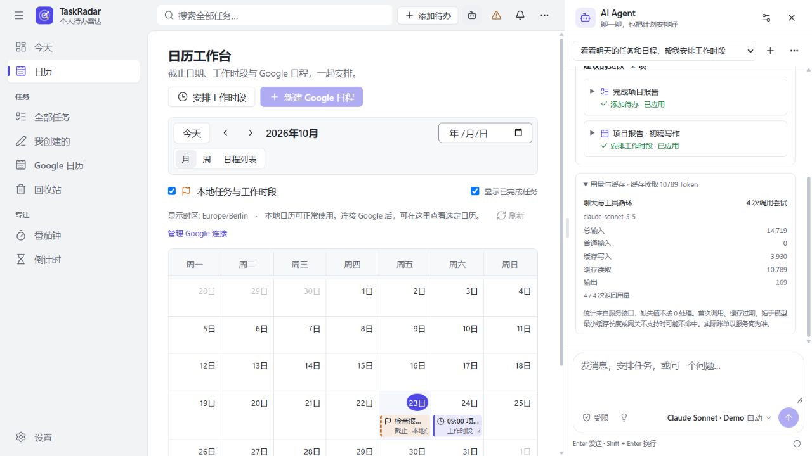
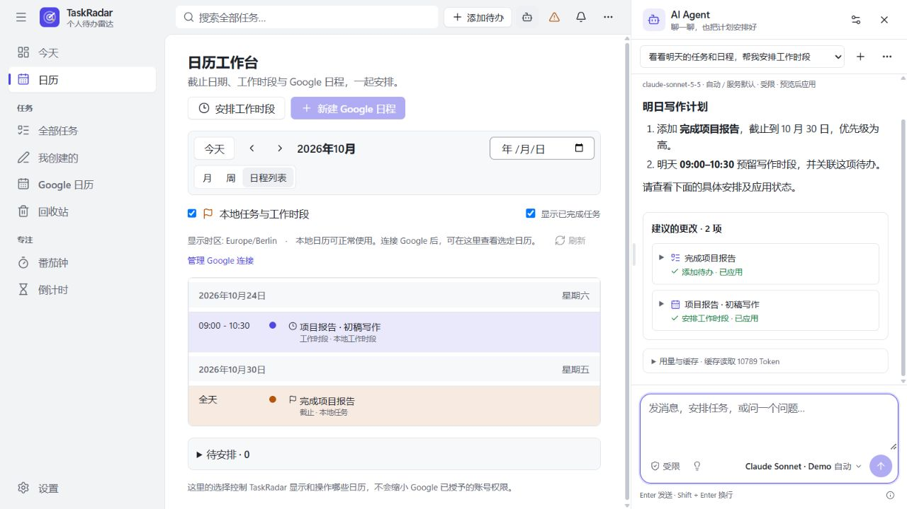
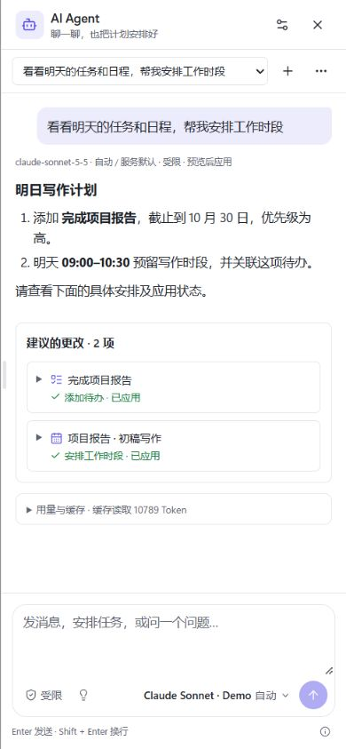
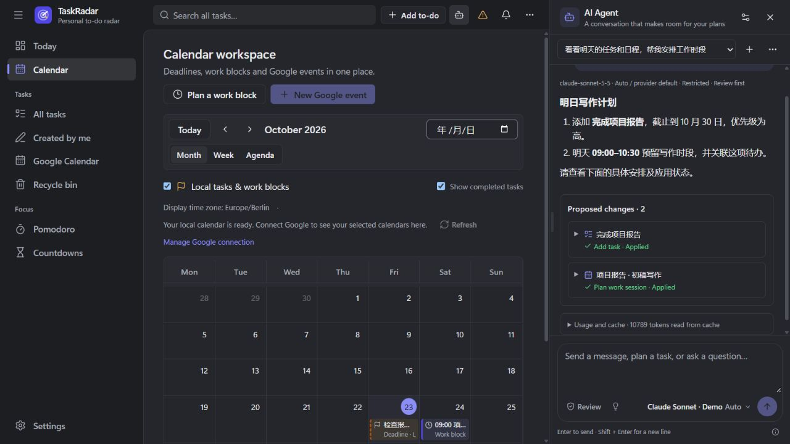

# AI Agent

右上角的机器人按钮打开独立聊天侧栏。宽窗口与当前页面并排显示，窄窗口使用右侧抽屉。
聊天不会因切换日历、待办页面或收起侧栏而中断，尚未发送的输入也会保留。
拖动侧栏左边缘即可调整宽度，宽度会在本机记忆。边缘也支持键盘左右方向键微调、Home/End 调至边界、
双击恢复默认宽度；窗口变窄时自动限制宽度，恢复宽窗口后保留原来的偏好。
聊天回复支持 Markdown 标题、强调、列表、任务列表、表格、引用、代码块、链接和公式。
代码块与宽表格独立横向滚动。原始 HTML 不执行，图片显示为可点击链接。

聊天控件集中在输入框底部的一行工具栏：左侧显示受限/YOLO 模式与提示词建议入口，右侧显示「模型 + 思考等级」
和发送按钮。点击模型按钮展开模型、思考等级、刷新和能力说明；点击模式标记切换执行方式。
隐私说明可通过输入框下方的信息按钮查看。默认聊天区不再常驻整块配置表单。

## 连接 API

在 **设置 → AI Agent** 选择服务商、填写模型 ID、API Base URL 和 API Key，然后保存。

| 选项 | 接口 | 默认地址 |
| --- | --- | --- |
| Claude | Anthropic Messages | `https://api.anthropic.com/v1` |
| OpenAI | Responses | `https://api.openai.com/v1` |
| 第三方 | OpenAI 兼容 Chat Completions | 改为供应商提供的地址 |

Base URL 包含 `/v1` 等版本路径，不附加 `/messages`、`/responses` 或 `/chat/completions`。
模型必须支持对应协议的工具调用；模型 ID 可以自由修改。自定义网关使用 HTTPS，本机服务允许 HTTP。
Claude 通过 Anthropic API Key 接入，不需要启动 Claude Code 终端；聊天订阅登录不能直接填入 API Key 字段。
切换协议时会填入对应默认模型和地址，再按供应商实际配置修改。

Key 仅存入系统凭据库，前端只能知道是否已配置。三个协议分别保存 Key，留空保存会保留已有 Key；
移除按钮仅删除当前协议的 Key。以前版本留下的 LLM 提取 Key 不会自动用于 Agent。

## 模型检测与思考等级

已配置 Key 后，打开侧栏或 Agent 设置会自动调用当前服务的 `/models`，也可点刷新按钮重新检测。
检测结果按协议、地址和凭据在内存缓存 5 分钟，支持分页；点击输入框右下角的模型按钮，在弹出面板中切换模型。
这里的 harness 指配置的 API 协议和服务地址，不扫描本机 Claude Code、Codex 等 CLI 的登录或模型。
更改地址或 Key 后需先保存，再检测该服务。供应商不提供模型列表时仍可在设置中手动输入模型 ID。
模型出现在列表中表示该服务报告了它，并不保证账户可调用其所有功能或该模型支持工具调用。

输入框模型菜单与设置中的「思考等级」随当前模型和协议变化，调整从下一条消息生效：

| 协议 | 思考参数与能力依据 |
| --- | --- |
| Claude Messages | 优先使用模型列表中的 effort/thinking 能力；支持自适应思考的模型发送 `output_config.effort`，较早的思考模型使用 `thinking.budget_tokens`（低 1024、中 4096、高 8192） |
| OpenAI Responses | 已核对模型使用 `reasoning.effort`，提供该模型支持的等级 |
| OpenAI 兼容 Chat Completions | 使用 `reasoning_effort`；支持服务明确报告的 `reasoning_efforts`，已知 OpenAI 模型可使用文档规则 |

界面标明能力来自服务接口、已知文档或尚未确认。「自动」不发送额外思考参数，保留服务默认行为。
未知模型或未经核对的特殊变体只提供自动；服务明确报告的能力优先于文档规则。
例如 Claude Sonnet 4.6 不提供 xhigh，GPT-5.4 mini 提供 none/low/medium/high/xhigh。
部分较新的 OpenAI 模型在 Chat Completions 中不支持带思考的工具调用，规划任务建议选择 Responses 协议。
思考等级影响模型计算预算，界面不展示模型内部思考链。

## 执行模式、标题与建议

- **受限模式（默认）**：先生成具体方案，检查后点击「应用更改」。
- **YOLO 模式**：成功回复后自动应用本轮新生成的方案，并逐项显示应用结果；以前尚未应用的方案保持待处理。
  本地修改冲突、Google 权限与 ETag 检查继续生效，失败项保留原因和重试入口。只想问答时可关闭工作区访问。
- **自动标题**：默认从首条消息提取，不增加 API 调用。在设置中选择「使用模型生成」，即可在首次成功回复后生成标题。
  「标题生成模型」可单独选择当前服务中的另一个模型，留空使用聊天模型。聊天菜单还可手动重命名或重新生成标题；
  自动生成不会覆盖手动标题，生成失败会保留原有标题。
- **提示词建议**：在设置或输入框底部的灯泡菜单选择关闭、预设建议、模型生成后续建议。
  模型建议在成功回复后生成，也可手动刷新；点击建议只填入输入框，仍由用户发送。

模型标题和模型建议会额外消耗当前服务的 API 额度，并发送有限的聊天上下文；这两类请求没有待办/日历工具。
辅助生成失败不会丢失主回复或已应用的结果。默认使用首条消息标题和预设建议。

## Claude 缓存与用量

Claude Messages（包括兼容该协议的网关）默认启用 5 分钟提示词缓存。在设置中可选择关闭、5 分钟或 1 小时。
使用内容块上的 `cache_control`，兼容尚未支持顶层自动缓存参数的服务：固定系统提示词作为基础断点，
本轮用户输入作为工具循环中的稳定断点，末尾可缓存块作为增长断点，总计不超过三个断点。
不直接给 thinking 块加标记，也不会为了“预热”额外请求模型。

系统提示词不再插入实时钟表、语言或执行模式；这些值只随本轮用户上下文发送，并在同一工具循环中固定。
历史用户上下文和回复时的方案状态保存为不可变文本。后续应用、放弃或失败的最新状态通过新消息补充，
既保留可复用前缀，也让 Agent 知道真实的应用结果。旧记录第一次重用时会补充状态快照。
跨轮只重放有上限的聊天文本和结果摘要，工具返回的大段数据与内部思考不会为了缓存而永久重放。

回复下方的「用量与缓存」显示服务返回的 `input_tokens`（普通输入）、`cache_creation_input_tokens`（写入）、
`cache_read_input_tokens`（读取）和 `output_tokens`。聊天工具循环、标题生成、提示词建议分别统计调用尝试与用量。
Claude 总输入等于前三项之和。缺失字段显示「未返回」，不会当作 0；某次调用缺少字段时，该组不会给出不完整的汇总值。
生成标题或刷新建议后，也会刷新对应聊天的统计。

首次请求通常要写缓存；TTL 到期、模型/思考设置变化、历史裁剪、前缀短于模型要求，或网关未实现缓存时仍可能不命中。
缓存写入计费，1 小时写入单价更高，因此默认保留 5 分钟。第三方网关可忽略缓存参数或不返回统计；
若不支持此参数，可在设置中关闭。实际命中和费用以服务商返回值及账单为准，界面不估算货币费用。
依据：[Claude Prompt caching](https://platform.claude.com/docs/en/build-with-claude/prompt-caching)。

## 聊天与安排

普通知识问答直接回复，不需要查询待办。例如「解释一下番茄工作法」。

与任务、日历有关的输入可以触发按需查询，例如：

- 「看看明天的任务和会议，帮我安排两个写报告的工作时段。」
- 「添加待办：下周五前完成项目报告，优先级高。」
- 「把提交报告的截止日期改到周五，并标记为进行中。」
- 「在我选中的个人 Google 日历里，把周四的项目讨论挪到 14 点。」

Agent 会获得应用设置中的时区和当前时间，能够查询待办、所选日历缓存、工作时段及重叠情况。
只有日期的截止时间不会自动补一个时刻；有歧义的日期、夏令时切换产生的重复或不存在的时刻应先澄清。
普通本地日程和工作计划保存为工作时段，可关联待办，不改变待办本身的截止日期。
本地工作时段沿用现有的数据结构，保存标题、起止时间、关联待办与缓冲；额外说明可写入关联待办，地点可放在标题中。
Google 日程支持独立的说明与地点字段。

所有写操作先生成方案。**受限模式**下，检查每项的日期、时间、时区、状态及重叠提示后点击 **应用更改**；
**YOLO 模式**下，本轮方案会自动应用。应用后主界面刷新；尚未应用的部分可以放弃。

应用时会检查本地项目是否在生成方案后又被修改，Google 事件继续使用原有的权限检查、草稿和 ETag 条件写入。
冲突不会覆盖他人的修改。部分失败会逐项显示，重试跳过已经完成的项目，避免重复创建。
删除任务进入原有的 30 天回收站。放弃方案或删除聊天不会撤回已经应用的操作。

## 数据与限制

- 消息、有限的历史上下文，以及工具按需查询的相关任务与日历数据会发送至配置的 API。
  关闭「允许助手使用待办和日历」后，不提供查询和修改工具，保留普通聊天功能。
  旧聊天中已经出现的内容仍属于该聊天上下文，需要移除时可以开始新聊天或删除旧聊天。
- 记录、方案和应用结果保存在本机 SQLite，支持切换历史聊天和删除聊天；数据导出与删除全部数据包含这些记录。
  不包含正文的数据导出会省略聊天标题、消息、方案和生成的建议。删除聊天不会删除已创建的待办或日程。
- Google 读取使用本地缓存，缺少覆盖范围时会提示，不能保证离线缓存代表最新空闲时间。可先在日历页刷新。
  Google 编辑仍要求已连接、已选中且可写的日历。重复、邀请和特殊类型事件继续通过 Google 页面编辑。
- 本地待办的 Google 镜像仍使用现有同步流程。Agent 修改或删除本地待办后，侧栏会提示到任务详情检查同步或移除；
  不会偷偷改变 Google 镜像或自动写入一个未预览的事件。
- 当前为文本聊天和工具调用，使用请求中的「正在思考」提示；没有流式逐字输出、浏览器搜索、终端或任意代码执行。
  每条消息最多生成 20 项更改，工具循环及发送的历史上下文有上限，较大的安排请拆成几条消息。

## 验证

后端测试使用内存凭据库、临时数据库、模拟模型及 Fake Calendar；覆盖三种 API 协议、思考参数、模型分页与缓存、
预览/自动应用、幂等提交、部分失败、手动修改冲突、Google 权限与 ETag、辅助生成失败、时间歧义、数据导出和删除。
前端测试覆盖 API 配置、Key 留空保留与保存后清空、Markdown 与不可信内容、拖动和键盘调整宽度、模型与模式切换、
标题与提示词建议、普通聊天、预览与应用、放弃方案、输入法回车和输入保留。
缓存测试还覆盖断点与 TTL、工具循环前缀不变、时间/执行模式/方案状态变化、旧聊天兼容、上下文裁剪、
按调用组汇总用量、缺失字段与真实零值的区别，以及重复提交不重复记录用量。

[本机 UI 验证环境](../scripts/agent-check/README.md) 还通过真实 HTTP 适配器连接脚本化的本地 Claude 兼容服务，
用于检查完整聊天 → 方案 → 应用 → 待办/日历刷新流程，不接触真实账户。已检查宽/窄窗口、中文/英文和浅/深色。
没有使用真实 API Key，因此真实供应商认证、账户额度、第三方兼容性及模型规划质量仍需配置后验证。

实现依据：[OpenAI Function calling](https://developers.openai.com/api/docs/guides/function-calling)、
[OpenAI Models](https://developers.openai.com/api/reference/resources/models/methods/list)、
[OpenAI Reasoning](https://developers.openai.com/api/docs/guides/reasoning)、
[GPT-5.4 mini](https://developers.openai.com/api/docs/models/gpt-5.4-mini)、
[Claude Models](https://platform.claude.com/docs/en/api/models/list)、
[Claude Effort](https://platform.claude.com/docs/en/build-with-claude/effort)、
[Claude Messages API](https://platform.claude.com/docs/en/api/messages/create)。能力规则核对日期：2026-10-23；默认模型 ID 可按服务商更新。
