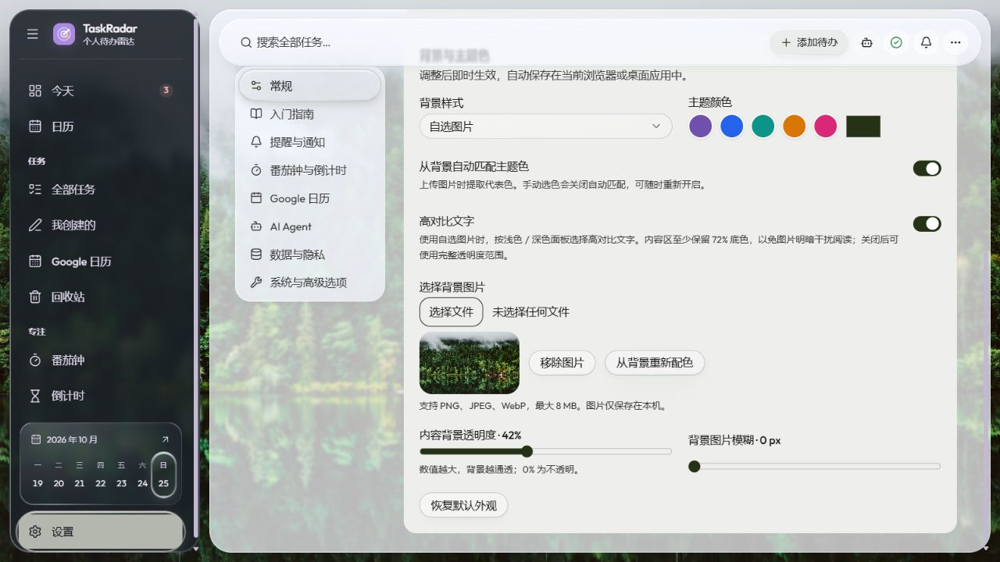

# Liquid Glass 界面与回退

2026-10-24。参考用户提供的日历布局、Apple 胶囊导航和透明 Dock 图片。

## 0.4.0 外观设置（2026-10-25）

设置中的“背景与主题色”支持默认丝带、纯色和本地 PNG/JPEG/WebP 图片（最大 8 MiB），
可自动从图片提取主题色、手动选择颜色、调节透明度和模糊，并启用高对比文字。
设置保存在当前浏览器或桌面 WebView 配置中，背景图片使用 IndexedDB；不包含在数据库 JSON 导出中。
手动改色会关闭自动配色，可随时重新开启；存储失败会提示错误，不显示为已成功保存。



## 存档

开始修改前，已把工作区原有的所有已修改文件和新增文件提交保存：

- 原始界面标签：`ui-before-liquid-glass-20261024`
- 原始界面分支：`codex/ui-before-liquid-glass-20261024`
- 原始界面提交：`b35361e29d30ff263d51203615cf001f894ab3bb`
- 第一版磨砂方案另存为标签：`ui-frosted-iteration-20261024`
- 弹性切换与日历快捷入口改动前：`ui-before-liquid-motion-20261024`
- 弹窗正文可读性修复前：`ui-before-dialog-reading-20261024`
- 二级菜单弹跳动画改动前：`ui-before-popup-spring-20261024`
- 动态脚本加载失败修复前：`ui-before-asset-loading-fix-20261024`
- 按钮形变与菜单衔接改动前：`ui-before-trigger-morph-20261024`
- 平滑动画、边框衔接与性能修复前：`ui-before-smooth-performance-20261024`（`ce8d388`）
- 本次平滑动画与性能修复版本：`ui-smooth-glass-20261024`
- 收起侧栏对齐修复前：`ui-before-rail-alignment-fix-20261024`（`9dcdfba`）
- 侧栏对齐修复版本：`ui-rail-aligned-20261024`
- 被撤回的浮雕方案存档：`ui-before-ios-clear-glass-20261024`（`d185c8a`）
- 仅撤回浮雕、保留此前修复：`ui-relief-reverted-20261024`（`c575ee0`）
- 按 iOS 参考收细轮廓的版本：`ui-ios-clear-glass-20261024`
- 当前方案分支：`codex/liquid-glass-ui`

存档保留了修改开始前尚未提交的桌面服务、日历页面、测试和文档，不仅是最后一个历史版本。
Git 保存源码，不包含用户数据库、账号凭据和构建产物。

## 当前材质

这一版使用几何生成的透镜位移贴图和 SVG `feDisplacementMap` 处理**页面实际背景**。
圆角与边缘按曲面法线及玻璃折射率计算采样偏移。静态面板中央保持平直，正文位于材质之上；
选中玻璃材质始终位于文字下方；切换时，独立透明折射层对实际文字和图标做局部放大与边缘弯曲，
并在动画完成前渐退至透明，平稳恢复清晰显示。
光学滤镜处理实际背景，叠加统一的轻微雾化与饱和度：面板 1.5 px、小控件 0.75 px，浮层 10 px。
细轮廓、轻微反射与背景边缘折射表现透明材质；指针追随高光只在小控件上更新，避免大面板持续重绘。

顶部胶囊导航浮在滚动页面上，因此滚动内容经过导航背后时也会发生折射。
侧边栏使用深色透明材质；页面、日历工具栏与容器、菜单、弹窗、概览卡片、输入框、提示、通知、开关和 AI 侧栏共享同一材质。
背景丝带为本地 SVG，Outfit 字体也已随应用保存，不需要外部 CDN。

这是 Web/WebView 内的光学模拟，透明范围是应用页面内的背景，不会透视到 Windows 桌面。
Chromium 和桌面版 WebView2 启用 SVG 背景折射；其他引擎保留低模糊透明材质与玻璃边框。
系统要求减少透明度或提高对比度时停用折射并切换为实色，要求减少动画时停用指针追随高光。
Canvas 不可用时保留 CSS 材质，避免影响软件功能。

位移贴图仅来自面板宽高和圆角，不截图、不读取页面内容。几何计算和 PNG 编码在 Worker/OffscreenCanvas 中完成，
按尺寸合并请求并缓存最多 96 份；不支持时使用最大边 128 px 的同步回退。
缩放结束后合并更新；静止时没有持续的 JavaScript 动画循环。

## 验证

- 本次前端 257 项测试、ESLint、TypeScript 与生产构建全部通过。
- 透镜中心不偏移、相对边缘对称、圆角双轴折射、小尺寸边界及 Canvas 失败回退测试。
- 侧边栏日期快捷入口、时区跨日和日历内日期跳转测试。
- 桌面启动与重启相关的 51 项后端测试，以及改动的 Python 文件的 Ruff 检查。
- Chromium 中使用同一实际材质对照清晰网格，确认边缘网格确实弯曲而标签保持清晰；
  检查浅色、深色及窄窗口布局。预览使用隔离的演示数据库和 Fake Calendar。

光学实现：`frontend/src/lib/liquidGlass.ts`、`frontend/src/components/ui/LiquidGlassEffects.tsx`。
设计样式：`frontend/src/glass.css`。截图位于 `docs/screenshots/liquid-glass-*`。

### 液态切换收尾的文字抖动修复（最新，2026-10-25）

此前在动画结束时，将整个玻璃从文字上方移回下方，导致放大字形一帧内切回原字形。
现在材质与高光始终位于文字下方，只有独立、无底色和无边框的折射层经过文字；不再在收尾时切换材质层级。

保留原有 480 ms 液滴位移、前后缘时差和到达形变。折射层与材质共用同一时间起点及几何关键帧，
72 ms 内渐入，264–456 ms 平滑渐退，最后 24 ms 已完全透明；动画完成时清理不会改变字形。
快速反向点击继承当前可见的折射不透明度，旧动画回调不会取消新动画；尺寸变化只调整材质。
完成、中止、减少动画与卸载时同步清理两层动画。装饰层均为 `aria-hidden`、`pointer-events: none`，原控件保持不变。

两层的光学几何相同，复用 Worker 中缓存的位移贴图。关键帧一次生成并交给浏览器播放，没有逐帧 JavaScript 循环。
新增回归覆盖渐入/渐退、结束前透明、快速中断时的透明度衔接、清理与光学缓存复用。
272 项前端测试、ESLint、TypeScript 与生产构建通过。

浏览器逐帧对比中，40 × 31 px 的目标文字区域在 479 ms 和 480 ms 完全一致，
自然进入 `idle` 后字形包围盒仍相同。真实任务页连续切换后，每组选中层与折射层各 1 个，
材质层级始终为 -1，结束时折射层透明度为 0；收起侧栏宽度与滚动内容宽度均为 76 px，页面无横向溢出。
深色快速切换和浅色任务页均无浏览器错误或警告。画面使用隔离的演示数据。

实录：[正反向平滑收尾](screenshots/liquid-glass-smooth-settle.gif)、
[实际任务页](screenshots/liquid-glass-smooth-settle-tasks.jpg)、[深色收尾](screenshots/liquid-glass-smooth-settle-dark.jpg)。

### 日程列表的今天标记（此前版本）

当天日期旁新增“今天 / Today”胶囊标签，日期文字和左侧细线使用主题色；吸顶栏继续使用实色读取底层。
标记沿用 FullCalendar 按显示时区提供的 `isToday`，并带有 `aria-current="date"` 语义。
仅真实当天显示标记；当天没有日程时，后面的日期保持普通样式。

21 项日历页面回归、ESLint、TypeScript 与生产构建通过。回归包含跨时区日期、唯一标记和当天无日程的情况。
浏览器检查了 1202 × 956 浅色/深色及 390 × 844 手机布局，标签完整，未产生横向溢出或运行警告。
截图：[今天标记](screenshots/calendar-agenda-today-marker.jpg)、[浅色日历](screenshots/calendar-agenda-today.jpg)、
[深色日历](screenshots/calendar-agenda-today-dark.jpg)、[手机列表](screenshots/calendar-agenda-today-mobile.jpg)。

### 日程列表日期吸顶栏重影修复（此前版本）

FullCalendar 会把已经滚过的日期表头叠放在列表顶部。此前表头背景透明、内部底色也只有 22% 的不透明度，
多个日期和下方日程会一起透出来，产生文字重影。通用表头的 11 px 上下内边距还与列表标题自己的内边距叠加。

列表日期表头现在使用随主题切换的实色读取底层，并设置独立层级遮住旧标题及滚动中的日程。
仅日期标题移除多余外层内边距，内部保留一份 12 px 间距、13 px 字号和 20 px 行高，标题行从约 67 px 缩至约 45 px。
周/月网格的表头样式、日历容器的玻璃折射和原有吸顶行为继续保留。

21 项日历页面回归、TypeScript 与生产构建通过。浏览器检查覆盖 1202 × 956 浅色与深色列表的顶部、中部和末尾，
以及 390 × 844 深色列表连续滚过多个日期；日期文字清晰，手机无横向溢出，浏览器无错误或警告。
验证使用隔离的演示数据。截图：[滚动后的日期标题](screenshots/calendar-agenda-header-scrolled.jpg)、
[浅色日历](screenshots/calendar-agenda-header-light.jpg)、[深色日历](screenshots/calendar-agenda-header-dark.jpg)、
[手机列表](screenshots/calendar-agenda-header-mobile.jpg)。

### 切换结束后恢复清晰文字（此前版本）

修复“日程列表”等选中标签在停稳后仍被透镜放大、弯曲的问题。
只有 `data-motion="moving"` 且光学贴图就绪时，玻璃才会移动到文字之上。
初始显示、动画结束或取消、尺寸变化及按压静止选项时，材质都位于文字下方，保持原字形与字号。
减少动画、减少透明度、提高对比度和强制颜色偏好也会立即恢复文字上方的清晰显示。

动画成功完成或被取消时，统一恢复 `idle` 并清理 `will-change`；快速切换产生的旧动画回调不会提前结束新动画。
这一规则覆盖日历视图、侧栏、任务筛选、设置和日期快捷入口等所有共用选中层，玻璃形变与背景折射继续保留。

271 项前端测试、ESLint、TypeScript 与生产构建通过。新增回归覆盖自然结束、主动中止和旧动画延迟完成时的状态恢复。
在 1202 × 956 的实际日历界面连续切换“周、月、日、日程列表”，切换中透镜位于文字上方，
结束后所有选中层均为 `idle` 且位于文字下方，“日程列表”按钮本身无变换；浏览器无错误或警告。
演示数据截图：[静止切换器](screenshots/liquid-glass-rest-switch.jpg)、[完整日历](screenshots/liquid-glass-rest-calendar.jpg)。

### 文字与图标随透镜折射（此前版本）

修复选中玻璃始终位于文字下方、只能折射背景的问题。SVG 光学贴图准备完成后，选中玻璃移到文字之上，
由浏览器直接采样下方实际文字与图标；玻璃经过时产生局部放大与圆边弯曲，离开后恢复。
不复制文字、不改变字体或布局，装饰层保留 `aria-hidden` 和 `pointer-events: none`，点击与键盘目标仍是原控件。

液态透镜中央轻微放大（最多约 6%），向心位移上限为 6 CSS px；宽圆边使用较温和的折射，避免侧栏图标及短标签变成碎片。
8 位位移图以 128 为中性值，在 SVG 中校正到精确的 0.5，消除静止时整片内容的细小采样偏移。
文字透镜移除额外模糊。包含选中层的面板把背景滤镜移至独立伪元素，
避免嵌套的透明背景根让折射后的文字叠在原字上形成重影；静态面板仍保持平直中央与原有材质。
主页面材质放在滚动区外的独立装饰层，随内容滚动时仍覆盖整个工作区。

无 SVG 支持、Canvas 失败或用户减少透明度/提高对比度时，装饰玻璃留在文字后方；
对应 CSS 在偏好改变时立即恢复底层位置，避免等待观察器期间实色材质遮住文字。
这套处理自动覆盖现有侧栏、任务筛选、设置与日历等共用选中层，动画仍使用原有合成关键帧。

最终版本的 270 项前端测试、ESLint 与 TypeScript/生产构建通过。
新增回归覆盖向心放大与对称性、大透镜中央贴图、中性通道校正、失败回退、光学就绪状态清理，以及页面材质在导航后保持独立。
实际任务页连续切换三个导航后，选中层数量为 1，x/y/宽/高落位误差均为 0 px，侧栏无横向溢出，浏览器无错误或警告。
1202 × 480 设置页滚动到底部（160 px）后，页面材质与工作区的 y/高度误差均为 0 px；
390 × 844 手机导航中的透镜位于文字上方，页面无横向溢出。

预览：[真实组件正反向文字折射](screenshots/liquid-glass-text-refraction.gif)、[实际侧栏停稳画面](screenshots/liquid-glass-text-sidebar.jpg)。
画面全部来自隔离的演示数据；开发预览的“文字折射”开关可比较透镜位于文字上方或下方的效果。

### 按液态切换参考图调整（此前版本）

用户进一步提供了 TabBar 玻璃泡的参考图。本轮把选中层改成通透的浮起玻璃泡，切换时前缘先行，
尾部滞后 65 ms 追随，形成拉长、横向收窄、到达后鼓起收拢的 480 ms 动作。
长距离跳转的长度限制在原/目标长度较大者的 1.7 倍；纵向导航的横向鼓起限制在 3.5%，避免重新引入侧栏横向滚动。
窗口布局变化单独使用尺寸插值，快速切换仍从当前可见位置接续，原控件的布局与点击区域保持不变。

定位外层、折射玻璃体和高光边缘使用独立元素；玻璃体稍微超出选中项，边缘折射使用更深的液滴曲面，
中心保持清晰。按住当前选中项时玻璃泡扩大，释放、指针取消、窗口失焦或减少动画偏好会立即结束按压状态。
静态面板继续使用原来的较浅光学曲面；两种曲面使用独立缓存键，避免同尺寸下复用错误贴图。

侧栏、设置导航、任务筛选、番茄钟阶段、倒计时方式、日历视图和日期快捷入口共同使用该实现。
41 个形变关键帧一次生成后交给浏览器合成，没有逐帧 JavaScript 计算。

动态预览：[共享组件正反向切换](screenshots/liquid-glass-droplet-switch.gif)。该 GIF 来自实际组件的浏览器逐帧截图，
开发预览位于 `frontend/dev/liquid-preview.html`，运行 `npm run dev` 后可通过 `/dev/liquid-preview.html` 手动切换、暂停检查。
开发预览不进入生产构建。新增回归覆盖前后缘相位差、反向对称、途中收窄/到达鼓起、侧栏边界、按压清理及光学缓存隔离。

实际任务页连续切换三次后仍只有一个选中层，落位的 x/y/宽/高误差均为 0 px。
840 × 600 深色导轨的滚动区宽度和内容宽度均为 76 px；390 × 844 页面宽度和内容宽度均为 390 px。
另检查了手机导航抽屉的正文遮挡与选中状态。
截图：[深色导轨](screenshots/liquid-glass-droplet-rail-dark.jpg)、[手机抽屉](screenshots/liquid-glass-droplet-drawer-dark.jpg)。

以下记录中的 420 ms 弹簧、31 个关键帧和较实的选中底色均已被本轮液滴切换替代。

### 参考 CYLTabBarController 的统一材质与弹性动效（此前版本）

本次参考 [CYLTabBarController](https://github.com/ChenYilong/CYLTabBarController)，核对源码版本
`ef759dcd121f7cc7560fc4129addada15590a709`。该库的玻璃来自 iOS 原生 TabBar；这里采用适合 WebView2
的独立实现，没有引入 UIKit 或 Lottie 运行库。选中图标参考其 `Example/MainTabBarController.m` 中的缩放节奏，
降低幅度并缩短时间；玻璃选中层使用 420 ms 阻尼弹簧、方向性拉伸和最多 6 px 的位置回弹。

弹簧的 31 个关键帧在切换时一次计算，再交给 Web Animations API。连续点击从当前可见位置接续；
图标只在选中目标变化时播放，窗口尺寸变化不重复播放。菜单、表单及触发透镜采用 360 ms 的统一节奏，
菜单在触发形变开始 42 ms 后展开；真实按钮和定位锚点保持静止。

`GLASS_SURFACES` 集中登记所有玻璃表面，补齐此前没有折射的输入框、日历容器与来源胶囊、
任务列表、状态面板、设置导航、开关圆点和通知。提示气泡也使用共用浮层材质。
折射、细轮廓、顶面高光、底缘阴影与主题底色一致；正文仍使用不透明的弹窗底色，表单外缘为 4 px。
不支持 SVG 背景滤镜时保留 CSS 玻璃；超过 150 万 CSS 平方像素的面板仅使用 CSS 材质。

减少动画会立即取消选中层与图标动画、清理 `will-change` 和指针高光；减少透明度、提高对比度或强制颜色时停用光学效果。
回归测试覆盖长距离与尺寸回弹范围、快速中断后的清理、各类表面的接入、SVG 不可用回退及偏好变化后的滤镜清理。

本次在隔离的 Fake Calendar 数据中检查了 1280 × 720 浅色/深色页面及 390 × 844 窄窗口，
确认导航抽屉正确遮挡、表单正文清晰、页面没有横向溢出；浏览器没有错误或警告。
截图：[总览](screenshots/liquid-glass-cyl-dashboard-light.jpg)、[日历](screenshots/liquid-glass-cyl-calendar-light.jpg)、
[表单](screenshots/liquid-glass-cyl-dialog-light.jpg)。

以下各节保留此前迭代的验证记录；其中旧的 240/280/320 ms 时序、材质透明度与截图代表当时版本，当前值以本节为准。

### 导航弹层在缩放下的遮挡修复

导航抽屉现在明确使用 `surface="navigation"`，不再叠加通用 `glass-dialog` 材质。
菜单文字区使用独立的实色读取层，玻璃折射保留在外缘；打开时隐藏下方导航导轨，并将主界面
设为 `inert`。菜单通过 body 中的 Portal 弹出，继续保留遮罩、键盘焦点约束和 Esc 关闭，
关闭后恢复打开按钮的焦点。点击遮罩不会触发下面的卡片。

滚动发生在菜单内部，外部读取层与关闭按钮保持固定，避免低高度窗口滚动后再次穿透。
已验证触发问题的 1088 × 956、设备像素比 1.25 的布局，以及 360 × 320 和 840 × 480 的真实页面视口。
新增三项集成回归测试，覆盖独立 Portal、底层禁用、焦点约束、Esc 恢复和导航后的交互恢复。
修复截图为 `liquid-glass-navigation-fixed.png`，短窗口滚动截图为 `liquid-glass-navigation-viewports.png`。

### 共享平滑切换、菜单可读性与日期快捷入口

导航、任务筛选、设置分区、番茄钟阶段、倒计时方式、日历视图和侧栏日期统一使用持续存在的玻璃选中层。
选中层以 240 ms 单调减速曲线移动，平滑落稳；连续点击会从当前显示位置重新计算。
通过 Web Animations API 提交 transform 关键帧，浏览器合成动画，静止时没有逐帧 JavaScript 计算。
移动时保留 SVG 背景折射，尺寸变化时重用或异步准备透镜位移贴图；系统要求减少动画时直接定位。
页面与分区只让标题轻量淡入，避免整棵玻璃元素树一起缩放或改变透明度。
新增分组可通过 `data-selection-scope` 使用相同实现，侧栏折叠时选中层的尺寸变化也会平滑衔接。

“添加待办”使用 36 px 高的玻璃胶囊按钮。原来的 `svg:only-child` 选择器会忽略文字节点，
误将图标加文字的按钮设为圆形；现在仅对显式的图标尺寸按钮应用圆形边框。
下拉菜单使用独立的读取底色（浅色 94%、深色 95%），边缘继续保留折射与反光，避免透出下方文字和按钮。

侧栏每一天直接进入 `/calendar?date=YYYY-MM-DD&view=timeGridDay`，覆盖之前保存的月/周视图偏好。
日视图查询单日范围，展示当天截止任务、工作时段和日程；空日期显示提示。前后翻日会同步 URL、日期输入和侧栏选中状态。
今天用独立标记保留，与当前浏览的日期区分。

测试覆盖切换起止位置、单调运动、尺寸变化、日视图偏好、侧栏连续跳日、前后翻日及空日期。
隔离演示数据库中已实测上述各类切换，检查动画运行时折射滤镜持续存在，并验证菜单文字清晰。
截图：`liquid-glass-select-readable.png`、`liquid-glass-day-shortcut.png`、`liquid-glass-task-switch.png`。
实现：`frontend/src/components/ui/LiquidSelectionEffects.tsx`、`frontend/src/lib/liquidMotion.ts` 和 `frontend/src/liquid-motion.css`。

### 表单弹窗正文遮挡

通用表单、确认框和计时结束提醒使用不透明的 `--popover` 正文底色，阻止下方任务文字穿透。
通过 `background-clip: padding-box` 将底色限制在正文区域，外侧保留 2 px 的透明折射边缘与高光。
背景由弹窗自身绘制，滚动时无需额外的绝对定位遮挡层；也不依靠提高模糊强度消除重影。
导航抽屉继续使用独立材质。

隔离演示数据中验证了浅色、深色和展开“更多选项”的表单，确认正文不透字、SVG 折射滤镜继续存在，
浏览器没有运行错误。220 项前端测试、ESLint 和 TypeScript/生产构建均通过。
截图：`liquid-glass-dialog-readable.png`、`liquid-glass-dialog-readable-dark.png`。

### 从触发按钮展开的二级菜单

共用的下拉菜单、通知/状态浮层、选择框和提示使用同一套 280 ms 平滑动画：从按钮附近的小尺寸展开，
以 `cubic-bezier(.16, 1, .3, 1)` 减速停稳，不再过冲或回弹。关闭时用 140 ms 向原按钮方向收回。
CSS 根据 Radix 实际放置方向、对齐方式、
触发按钮尺寸和间距设置缩放起点；上、下、左、右弹出都适用，定位仍由 Radix 的外层负责。
选择框的原有 translate 间距改为 Popper sideOffset，使显示位置与动画起点一致。
系统要求减少动画时沿用全局无动画规则。

玻璃菜单插入 Portal 后立即请求折射贴图，无需等待通用尺寸更新的 75 ms 防抖；命中缓存时立即应用。
回归测试在不推进计时器的情况下验证缓存/回退路径。浏览器实测“更多”菜单向下展开和任务选择框向上展开，
最终缩放起点与按钮中心误差小于 0.1 px，动画过程中仍有 SVG 背景折射，关闭动画及通知浮层正常。
221 项测试、ESLint、类型检查及生产构建通过。截图：`liquid-glass-popup-spring.png`。

### 界面更新后的脚本加载失败

已修复连续构建清掉旧脚本、导致未刷新的页面无法切换到任务页的问题。
构建保留旧哈希资源，在新脚本与样式全部落盘后原子切换 HTML 入口；模块加载失败时提供重新加载当前页面的恢复入口。
原因、回归测试及实际浏览器验证见 [前端资源加载修复记录](FRONTEND_ASSET_LOADING.zh-CN.md)。

### 按钮形变与菜单衔接

所有共用 DropdownMenu、Popover 和 Select 触发按钮自动接入玻璃形变。按钮先压缩蓄力，再朝菜单实际放置方向拉伸，
菜单在 60 ms 后开始展开，形成连续动作；按钮玻璃层和图标在 320 ms 内完成一次轻微压缩、延伸和复位。
形变幅度按按钮尺寸限制，宽选择框不会大幅横向扩张。

`PopupTriggerEffects.tsx` 只给按钮添加 `aria-hidden` 的装饰透镜层，并读取 `aria-expanded`、`aria-controls` 和菜单 `data-side`。
按钮的边框、底色和阴影统一绘制到变形透镜上，解决原边框留在原地的问题。
按钮本体保留布局边框宽度，但边框色、底色和背景滤镜清空；点击区域及 Popper 定位锚点保持静止。
选择框静止时也使用同一装饰透镜绘制边框，键盘焦点光环跟随透镜，深浅主题均使用语义颜色。
文字翻译或 React 更新移除装饰层后会自动补回；关闭和再次打开不会重复添加装饰层。
动画交给 CSS 合成，JavaScript 只在状态和几何变化时更新；系统减少动画时取消形变与衔接延时。

浏览器验证了鼠标、键盘打开“更多”以及任务选择框向上展开，原框已透明，边框和折射由形变层绘制。
按钮朝实际菜单方向略微延伸，菜单接着展开；按钮位置和点击区域保持不变，透镜滤镜持续存在。
新增三项真实 Radix 控件集成测试，覆盖 Tooltip 包裹、Esc 焦点恢复、再次打开、方向翻转、文字更新、卸载清理与键盘选择。
231 项测试、ESLint 和 TypeScript/生产构建通过。截图：`liquid-glass-trigger-handoff.png`。

### 搜索框融合与高刷新率优化

顶部搜索输入改为透明、无内框，直接使用顶栏玻璃底材。键盘聚焦时只给输入区域一个轻量外光环，搜索提交行为保持正常。

侧栏不再逐帧改变宽度：先提交一次布局，再以 200 ms 合成变换移动工作区、伸缩独立侧栏材质。
页面文字不缩放，选中层跟随尺寸变化。快速反向操作会取消旧动画并从当前显示位置续接，结束后清理 `will-change`。
光学计算离开主线程，布局读取集中在样式写入之前；几何缓存避免反复生成相同透镜。

244 项前端测试、ESLint 与类型/生产构建通过。测试包括 Worker 去重/缓存/失败回退/卸载清理、
合成动画中断、减少动画偏好、无 Web Animations API 回退，以及选中层尺寸变化。
浏览器验证了浅色、深色、搜索提交、选择框边框与菜单方向。
性能数据和高刷新率验证范围见 [玻璃动画性能记录](GLASS_MOTION_PERFORMANCE.zh-CN.md)。
截图：`liquid-glass-smooth-focus.png`、`liquid-glass-smooth-focus-dark.png`。

### 收起侧栏的错位与裁切修复

复现时侧栏名义宽度为 76 px，但带负 inset 的玻璃装饰层使滚动区多出约 1 px 的高度，触发纵向滚动条。
实际内容容器只剩 48 px，默认 Grid 最小内容宽度又被长标签撑到约 68 px，造成图标偏右、选中背景和文字被裁切。
此前只验证选中层与条目是否重合，未验证条目是否超出侧栏；本次补充了后者。

玻璃材质现在固定在外壳中，滚动内容使用独立的 `.sidebar-scroll`；装饰层不进入滚动范围。
选中层的定位范围也移到该滚动区，保持随内容滚动。菜单使用 `minmax(0, 1fr)` 列和可收缩条目，
中英文长标签可在固定宽度内换行。收起模式保留滚动功能并隐藏占宽的滚动条，让正常及短窗口的图标都与外壳中心对齐。
展开/收起继续使用原有合成动画，不恢复逐帧宽度动画。

Chromium 中用真实页面的同源 iframe 检查了 1202 × 956、1202 × 540、840 × 480、1088 × 956 四种视口。
全部通过图标/条目居中、文字不横向溢出、选中层匹配、材质与外壳同尺寸的检查。
932 px 高的正常滚动区不再出现多余溢出，短窗口只保留内容需要的纵向滚动。
另验证了保存收起状态后重新加载、连续四次反向切换、展开模式和英文长标签。
测量数据见 [RAIL_ALIGNMENT_SAMPLES.json](RAIL_ALIGNMENT_SAMPLES.json)，截图为 `liquid-glass-rail-aligned.png`。

新增集成测试确保玻璃装饰层在展开与收起之间始终位于滚动区之外，滚动区不被重新挂载。
245 项前端测试、ESLint 与 TypeScript/生产构建通过；全新正式页面没有浏览器错误或警告。

### 撤回浮雕方案，按 iOS 参考调整

`c575ee0` 完整撤回 `d185c8a` 的曲面光照方案，恢复单张位移贴图，保留侧栏对齐、资源加载和交互修复。
该提交单独保留，可作为不含后续外观调整的纯回退版本。

后续样式以用户提供的 iOS 截图为参考：移除多层内阴影和宽亮边，轮廓降至 0.75 CSS px，减轻投影与大面积反射。
透镜曲面区域收窄，采样位移减小；真实背景仍通过原有 SVG 位移滤镜折射。
顶栏动作和选择器采用完整胶囊，顶栏图标保留透明圆形底材。菜单和表单仍有独立读取底色。
控件边框全部由变形层绘制，原锚点立即清空边框与底色，避免初次挂载的颜色过渡留下短暂原框。
高对比度偏好下恢复较强的控件轮廓，键盘焦点光环保持可见。

245 项测试、ESLint 与生产构建通过。浏览器验证了浅色、深色、胶囊选择器、菜单/表单读取底色、
无额外滚动条，以及收起侧栏 76 px 宽度与居中。正式页面无运行错误或警告。
截图：`liquid-glass-ios-clear.png`、`liquid-glass-ios-dark.png`、`liquid-glass-ios-select.png`。
这是 Web 中按参考方向进行的材质调整，不声称复现原生 iOS 的完整渲染行为。

## 回到原始界面

先提交或另行保存后续新增的修改，再在仓库根目录执行：

```powershell
git switch codex/ui-before-liquid-glass-20261024
cd frontend
npm run build
```

重新打开源码版 TaskRadar，或重新加载页面。重新构建是必要步骤，因为后端的静态资源不纳入 Git。
返回新方案时，在仓库根目录切换至 `codex/liquid-glass-ui`，再执行同样的前端构建。
此流程不改动任务、计时器或账号数据。

## 参考与字体许可

- [MDN：backdrop-filter](https://developer.mozilla.org/en-US/docs/Web/CSS/Reference/Properties/backdrop-filter)
- [MDN：feDisplacementMap](https://developer.mozilla.org/en-US/docs/Web/SVG/Reference/Element/feDisplacementMap)
- [Outfit 官方字体源](https://github.com/google/fonts/tree/main/ofl/outfit)；许可随文件保存在
  `frontend/public/fonts/Outfit-OFL.txt`。
